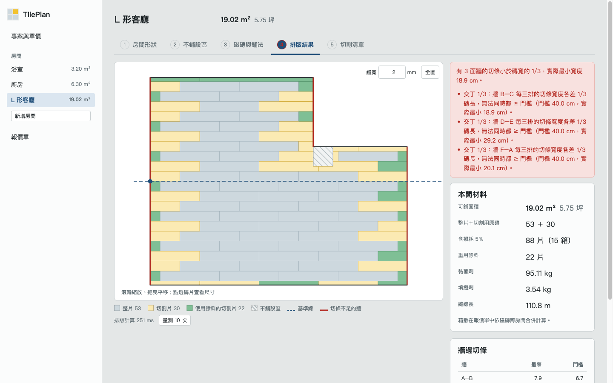
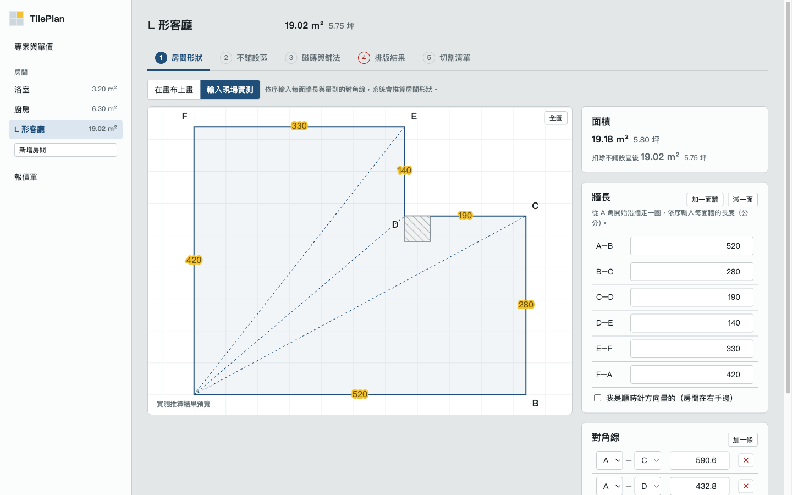
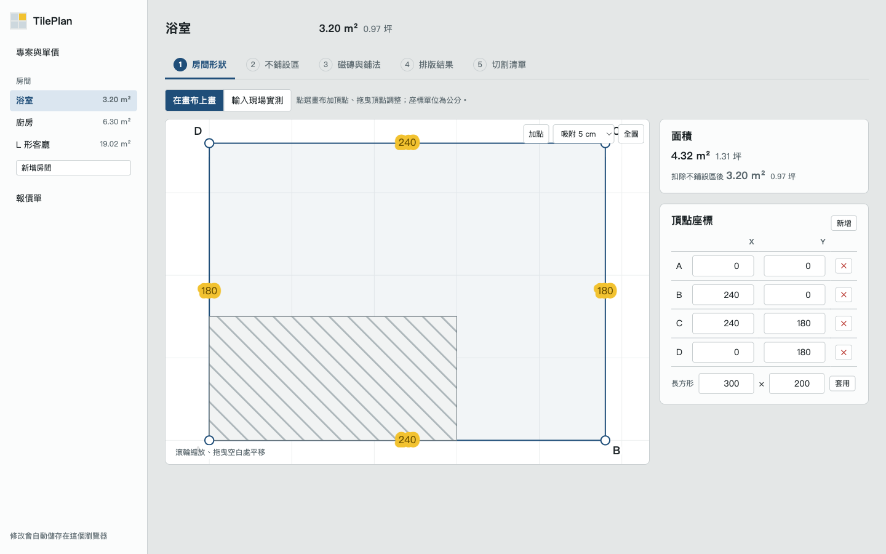
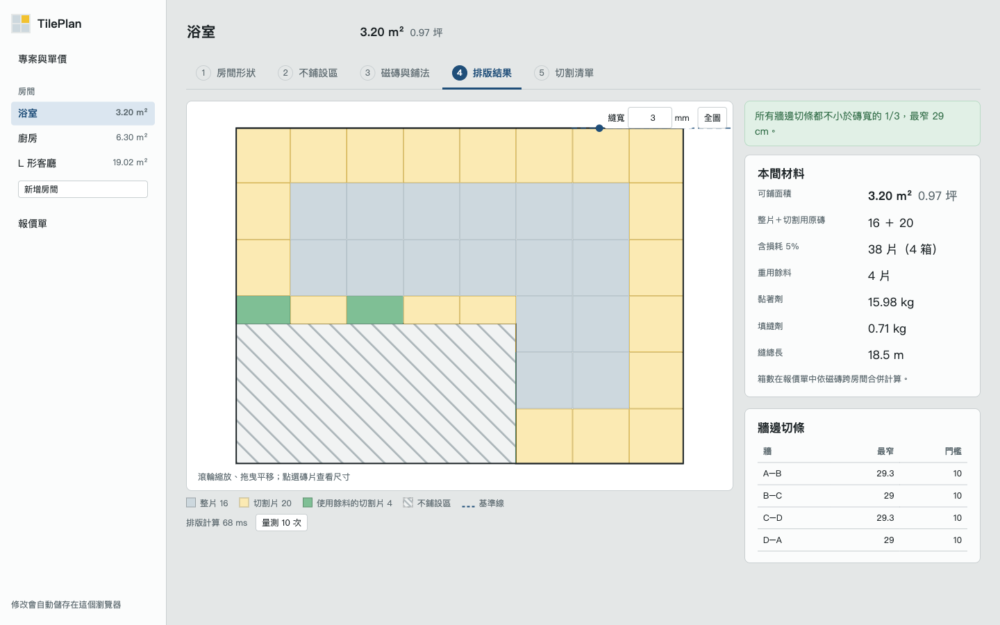
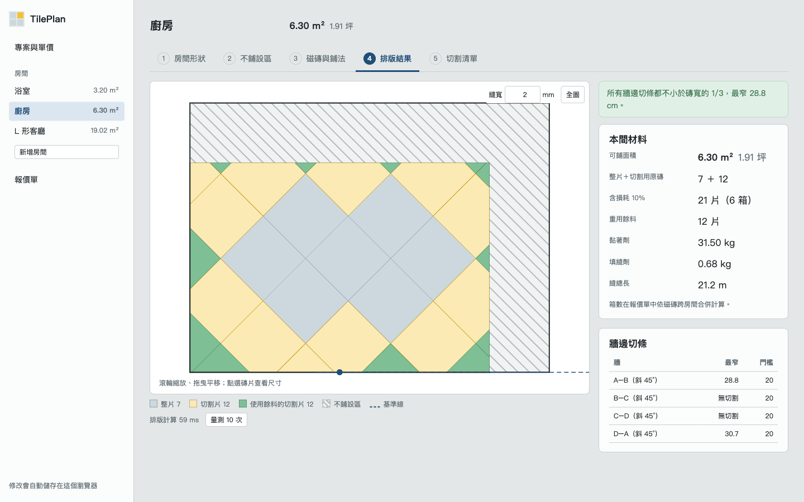
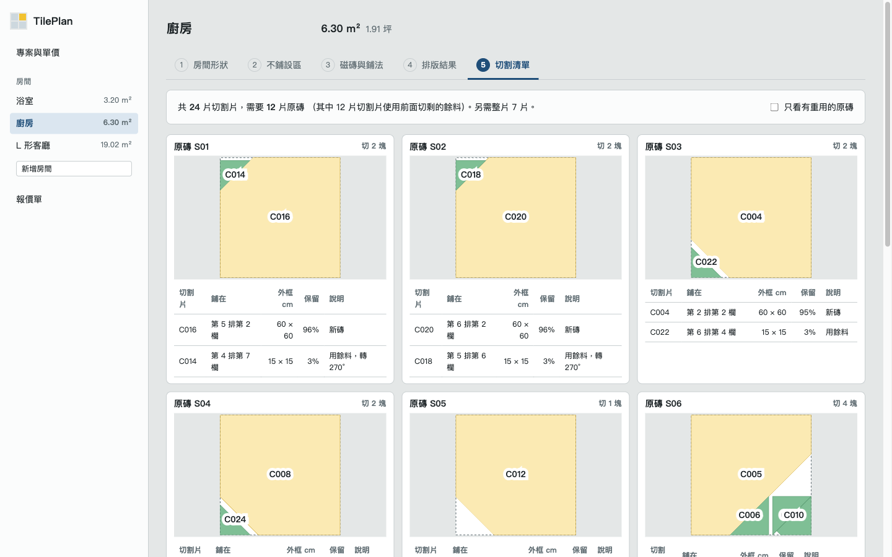
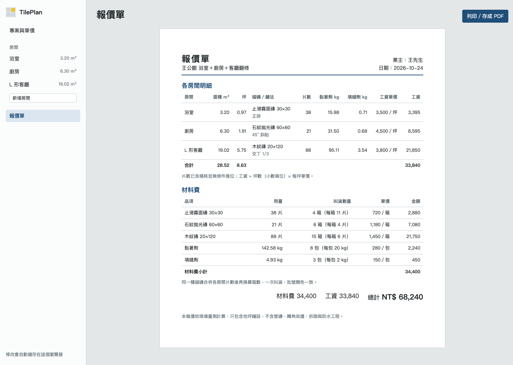

# TilePlan 磁磚排版與材料估算

給泥作工班用的地坪排版工具：畫出房間（或輸入現場量的牆長與對角線），自動排磚、產生切割清單、估算材料，最後印出報價單。

- **線上 Demo**：<https://hn83320589.github.io/TilePlan/>
- **技術**：.NET 10、Blazor WebAssembly（純前端，不需要後端）、Clipper2（多邊形布林運算）
- **系統分析與架構設計**：[docs/architecture.md](docs/architecture.md)



---

## 目錄

1. [啟動方式](#啟動方式)
2. [使用流程](#使用流程)
3. [由實測牆長與對角線推算房間形狀](#由實測牆長與對角線推算房間形狀)
4. [排版、偏移調整與餘料重用](#排版偏移調整與餘料重用)
5. [材料計算公式](#材料計算公式)
6. [測試與性質測試的設計](#測試與性質測試的設計)
7. [效能量測](#效能量測)
8. [畫面截圖](#畫面截圖)
9. [已知限制](#已知限制)

---

## 啟動方式

需要 [.NET 10 SDK](https://dotnet.microsoft.com/download)（10.0.100 以上）。

```bash
git clone https://github.com/hn83320589/TilePlan.git
cd TilePlan
dotnet run --project src/TilePlan.Web      # 開啟 http://localhost:5159
dotnet test                                # 執行全部測試
```

第一次開啟會自動載入範例專案（浴室、廚房、L 形客廳）。之後所有修改都會自動存在瀏覽器的 localStorage，重新整理後還原。

| 目錄 | 內容 |
|---|---|
| `src/TilePlan.Core` | 幾何、實測推算、排版、偏移、餘料、材料、報價、專案模型。不依賴 Blazor |
| `src/TilePlan.Web` | Blazor WebAssembly 介面 |
| `tests/TilePlan.Core.Tests` | xUnit：單元測試、手算測試、性質測試 |
| `tests/TilePlan.Web.Tests` | xUnit + bUnit：自動儲存還原、面積顯示 |
| `samples/` | 範例專案 `sample-project.json`、效能測試專案 `perf-400x300.json` |
| `.github/workflows/` | `ci.yml`（build + test）、`deploy.yml`（發佈到 GitHub Pages） |

## 使用流程

1. **專案與單價**：建立磁磚規格（長、寬、厚度、縫寬、每箱片數、每箱單價）與工資、耗材單價。
2. **房間形狀**：在畫布上點出多邊形，或切換到「輸入現場實測」，填牆長與對角線。
3. **不鋪設區**：加入柱子、浴缸、廚具底座（長方形或任意多邊形）。
4. **磁磚與鋪法**：選磁磚、鋪法（正排／交丁 1/2、1/3／45° 斜貼）、基準線（可一鍵設為某面牆的中點）與偏移（自動或手動）。
5. **排版結果**：檢查牆邊切條、點選磚片看尺寸與切割形狀。
6. **切割清單**：每一片原磚要切成哪幾塊、分別鋪在哪裡。
7. **報價單**：列印或用瀏覽器「另存為 PDF」，A4 直向。

專案可以在首頁匯出成 JSON，或從 JSON 匯入。

---

## 由實測牆長與對角線推算房間形狀

程式碼：`src/TilePlan.Core/Survey/`

### 需要幾條量測？

一個 n 邊形在平面上有 2n 個座標，扣掉整體平移（2）和旋轉（1）後還剩 **2n − 3 個自由度**。n 面牆長提供 n 個限制，所以還需要 **n − 3 條對角線**：

| 房間 | 牆數 | 需要的對角線 |
|---|---|---|
| 三角形 | 3 | 0 |
| 長方形（或任何四邊形） | 4 | 1 |
| L 形 | 6 | 3 |

只量四面牆時，所有邊長相同的平行四邊形都符合，所以系統**不會假設直角**，而是回報「缺少 1 條量測，建議再量 A–C」。

### 演算法

1. **剛性分析**：把牆和對角線當成桿件，在固定亂數種子產生的一般位置上組出剛性矩陣（rigidity matrix），用高斯消去求秩。秩 = 2n − 3 才能求解；不足時，從未量測的頂點對中貪婪挑選能提高秩的對角線，作為給師傅的建議（優先選不與既有對角線交錯、跨度短的）。
2. **逐點三邊定位**：A 放在原點，B 放在 +x 軸。之後每次挑一個「與已放置頂點有兩條以上量測」的頂點，用兩圓交點求位置。兩圓交點有鏡像兩解，兩個都試（深度優先），只保留同時符合以下條件的形狀：
   - 多邊形不自交；
   - 方向與量測方向一致（預設逆時針，也可選順時針）；
   - 每條量測的對角線都在房間內，因為捲尺不能穿牆。
   兩圓沒有交點時，回報哪幾條量測不滿足三角不等式。
3. **最小平方修正**：以第 2 步的結果為初始值，用 Levenberg–Marquardt 最小化 Σ(|pᵢ − pⱼ| − dᵢⱼ)²。有多餘量測時回報每條的殘差；最大殘差超過 1 cm 就提醒「量測可能有誤，請複量」。若修正後仍有兩個以上明顯不同的形狀，回報歧義，並建議最能區分它們的一條對角線。

先構造再修正，而不是直接做最小平方，是因為最小平方從錯誤的初始值出發，常會掉進「整個三角形翻到另一側」的局部最小值。

---

## 排版、偏移調整與餘料重用

### 排版（`Layout/LayoutEngine.cs`）

以基準線建立磚格座標 (u, v)：u 軸沿基準線，45° 斜貼時再轉 45°。每一格 = 一片磚 + 右側縫 + 上方縫，格子剛好鋪滿整個平面；交丁時第 j 排沿 u 方向錯開 `(j mod 週期) / 週期 × 模數`。

1. 可鋪區域 R = 房間 − ∪不鋪設區（Clipper 差集）。
2. **把 R 轉到磚格座標**。這樣每片磚都是對齊座標軸的長方形，旋轉誤差只會出現在房間邊界上一次，不會累積在每片磚上。
3. 把 R 的每條邊光柵化到格子上，記錄每格被哪些邊穿過。
4. 沒有被穿過的格子，不是整片在內就是整片在外，用格子中心點判斷即可。被穿過的格子再用 Liang–Barsky 確認邊是否真的進入磚的內部。只有確實被穿過的磚，才用 Clipper 的 `RectClip` 裁切。
5. 分類為**整片**或**切割片**；切割片保留鋪設後的形狀與在原磚上的形狀。被柱子切成兩塊的磚，視為同一片切割片的兩部分。

400 × 300 房間配 10 × 10 磚約 1,200 片，其中只有約 140 片需要裁切。

### 自動偏移調整（`Offset/`）

**牆邊條寬的定義**：貼著某面牆的切割片，其頂點到該牆的最大距離。這個定義對斜牆同樣適用，也能抓到三角形小碎片。門檻為「磚在垂直該牆方向的尺寸 × 1/3」。同時貼著兩面不平行牆的**轉角片**，形狀由兩面牆共同決定；只要牆上還有其他切片，就不把轉角片計入這面牆的條寬。

**評分**（依序比較，前者優先）：

1. 做得到的牆，切條都 ≥ 門檻；
2. 互相面對的牆，切條寬度越對稱越好；
3. 跨牆的磚越少越好，也就是切割次數越少越好；
4. 做不到的牆，最小切條越寬越好；
5. 偏移越接近基準線越好。

**搜尋**：最佳化要評估上百個候選偏移，所以用快速評估。每面牆近似成半平面，只算跨過牆的磚，計算純算術、不呼叫 Clipper。候選偏移包含：

- 解析解：與磚縫平行的牆只受 oᵤ 或 oᵥ 其中一個影響，可以直接算出「切條剛好等於門檻」「磚邊貼齊牆」「兩面對牆對稱」的偏移；
- 5×5 粗網格；
- 沿 u、v 軸（斜牆則沿兩條對角方向）的線搜尋與局部細化。

選定偏移後，以**精確排版**重新量測每面牆的條寬，產生報告。

**做不到時**，畫面會說明原因與實際最小寬度：

| 情況 | 說明範例 |
|---|---|
| 交丁 1/3 | 每三排的切條各差 1/3 磚長，牆的兩側無法同時都 ≥ 門檻 |
| 斜牆 | 牆與磚縫夾 3°，沿牆必然出現三角形小片 |
| 牆面衝突 | 單看每面牆都做得到，但 L 形不同牆段對偏移的要求互相衝突 |

正排在長方形房間一定做得到：剩餘量不足時少放一整排，兩側各 (r + m)/2 ≥ m/2 > m/3。這也寫成了測試，用 40 個隨機長方形驗證。

### 餘料重用（`Cutting/OffcutPlanner.cs`）

每片切割片都要從一片原磚上切下。這是 2D 裝箱問題的變形，用 **Best-Fit Decreasing** 貪婪法處理：

```
切割片依面積由大到小
for 每片切割片:
    在現有餘料中，找放得進去的最小一塊（候選位置：外框四角對齊、頂點對頂點；旋轉 0°/180°，可選 90°）
    找到 → 從餘料切下，剩下的部分放回餘料清單
    找不到 → 開一片新原磚，切割片放在它原本在磚上的位置
    比「最小的待切片」還小的剩料直接丟棄
```

- **放得進去**：凸多邊形餘料用「所有頂點都在內」判定，其餘情況用 Clipper 差集，容許量為沿周長 2 µm 寬的細縫。
- **保證**：關閉重用時每片切割片各用一片原磚；開啟後只會「用餘料取代新磚」，所以原磚數不會更多。
- 可設定刀口寬度。設定後切割片會先往外擴張半個刀口寬，再從餘料中扣除。

---

## 材料計算公式

程式碼：`Estimation/MaterialEstimator.cs`、`Quoting/QuoteBuilder.cs`

| 項目 | 公式 |
|---|---|
| 面積 | 鞋帶公式；m² = cm² ÷ 10,000；坪 = m² × 121 ÷ 400；顯示時四捨五入到小數兩位 |
| 基礎片數 | 整片數 + 切割用原磚數（已扣除重用） |
| 含損耗片數 | ⌈基礎片數 × (1 + 損耗率)⌉；損耗率預設正排、交丁 5%，斜貼 10%，可逐間覆寫 |
| 箱數 | ⌈同一種磁磚各房間含損耗片數總和 ÷ 每箱片數⌉（跨房間合併叫貨，同批號） |
| 黏著劑 | 可鋪面積（m²）× 每 m² 用量（kg）；包數 = ⌈總 kg ÷ 每包 kg⌉ |
| 縫總長 | 縫中心線裁切到可鋪區域內的總長度（每格：右側縫長 = 磚高，上方縫長 = 磚寬 + 縫寬，交叉點只算一次） |
| 填縫劑 | 體積 = 縫總長 × 縫寬 × 磚厚；重量 = 體積 × 密度（預設 1,600 kg/m³）；包數 = ⌈總 kg ÷ 每包 kg⌉ |
| 工資 | 坪數（顯示的兩位小數）× 該鋪法每坪單價，讓業主可以拿報價單自行驗算 |
| 金額 | 每一行四捨五入到元；總價 = 各行金額加總 |

片數、箱數、包數一律用 `decimal` 計算。若用 `double`，`100 × 1.05 = 105.00000000000001`，無條件進位後會變成 106 片，這個情況也寫成了測試。

**手算範例**（驗收 10）：300 × 200 房間、30 × 60 磚、縫 2 mm、厚 9 mm、偏移 0。
- 整片 24，切割片 11。切剩的 0.8 cm 和 11.2 cm 都放不下其他切割片，所以原磚 11 片。(24 + 11) × 1.05 = 36.75，進位為 37 片；每箱 8 片，37 ÷ 8 = 4.625，進位為 5 箱。
- 黏著劑 6.00 m² × 5 kg = 30 kg。
- 直縫 4 條 × (6 × 30 + 18.8) + 橫縫 6 條 × 300 = 2,595.2 cm；2,595.2 × 0.2 × 0.9 = 467.136 cm³；× 1.6 g/cm³ = 0.747 kg。

---

## 測試與性質測試的設計

```bash
dotnet test        # 83 個測試，全數通過
```

| 測試類別 | 內容 | 驗收 |
|---|---|---|
| `AreaTests` | 6.00 m²／1.82 坪、扣除柱子 5.64 m²、超出房間的不鋪設區、重疊的不鋪設區、四捨五入 | 2 |
| `SurveySolverTests` | L 形已知座標（兩組不同的對角線、量到 0.1 cm 的四捨五入）誤差 < 0.5 cm；缺對角線時回報缺少與建議；不是直角的老房子；三角不等式；多餘量測的殘差 | 3、4 |
| `LayoutEngineTests` | 正排、交丁 1/2、交丁 1/3、45° 斜貼的手算片數；切割尺寸；柱子把磚切成兩塊 | 5、6 |
| `LayoutPropertyTests` | 240 個隨機房間的面積守恆、磚片不重疊、不超出區域 | 8 |
| `OffsetOptimizerTests` | 長方形對稱且 ≥ 1/3、40 個隨機長方形都達標、交丁 1/3 與斜牆做不到時的原因與最小寬度 | 7 |
| `OffcutPlannerTests`、`OffcutPropertyTests` | 手算重用（22 片切割片 → 15 片原磚）、放得進去、同一片原磚上不重疊、旋轉與刀口；90 個隨機房間 | 9 |
| `MaterialEstimatorTests`、`QuoteBuilderTests` | 箱數進位、decimal 陷阱、黏著劑、填縫劑、跨房間合併箱數、工資、總價等於各行加總 | 10、12 |
| `ProjectTests` | 匯出再匯入後排版與報價完全相同、範例專案、版本檢查 | 13 |
| `AutoSaveTests`（Web） | 重新整理後專案還在、報價相同、存檔損壞時的處理 | 13 |

### 性質測試怎麼設計（驗收 8）

`tests/TilePlan.Core.Tests/RandomRooms.cs` 以**固定種子**產生 240 個隨機房間，三種類型輪流出現：

- **直角多邊形**：2–3 個互相重疊的長方形取聯集，形成 L、T、U 形；
- **星形多邊形**：隨機角度排序、隨機半徑，保證不自交，常有內凹角與斜牆；
- **斜牆多邊形**：長方形四角隨機切斜角。

每個房間再隨機加上 0–2 個不鋪設區（可能旋轉、可能超出房間），並隨機選擇磁磚尺寸、縫寬、四種鋪法、基準線角度與偏移。

檢查的不變量：

1. **|磚片面積 + 縫面積 − 可鋪面積| ÷ 可鋪面積 < 0.1%**
2. 磚片之間不重疊、不超出可鋪區域
3. 整片的面積剛好等於一片磚；切割片在原磚上的形狀不超出原磚

關鍵在於**縫面積必須獨立計算**：縫網路由磚格另外產生（每格的右側縫與上方縫），再與可鋪區域取交集。如果縫面積改用「可鋪面積 − 磚片面積」算，第 1 條就變成恆等式，什麼都驗不到。

實測結果：240 個房間的相對誤差都在 10⁻⁵ 以下，來源是 Clipper 的 1 µm 整數化。

---

## 效能量測

**情境**（驗收 11）：400 × 300 cm 房間、10 × 10 cm 磚、縫 2 mm，約 1,200 片。修改縫寬後，量測「重新排版 + 重繪」的時間。

**量測方式**：

1. 首頁按「效能測試範例」，進入房間的「排版結果」，按「量測 10 次」。
2. 程式交替修改縫寬 10 次，每次間隔 0.5 秒（模擬真人操作，並避開自動儲存）。
3. 每次從修改前的 `performance.now()` 開始計時，經過重新計算（自動偏移、排版、餘料配置、材料估算）、Blazor 重繪，到兩次 `requestAnimationFrame` 後停止，也就是瀏覽器真的把畫面畫出來為止。
4. 顯示中位數與最慢的一次。

**結果**（Release 建置、未使用 AOT；Chrome 155，macOS，Apple M4 Pro）：

| 鋪法 | 片數 | 中位數 | 最慢 |
|---|---|---|---|
| 正排 | 1,200 | 270 ms | 278 ms |
| 45° 斜貼 | 1,225 | 575 ms | 583 ms |

都在 1 秒以內。主要做法：

- 只有被牆邊穿過的磚才做多邊形裁切；
- 同類磚合成**一條 SVG path**，1,200 片磚只產生 3 個 DOM 元素；
- 平移縮放直接在 JS 修改 `viewBox`，不經過 .NET 重繪；
- 偏移最佳化的評估改用陣列並快取，轉角檢查只做在牆的兩端，搜尋方向依牆的種類決定；
- 餘料配置會記住「這個形狀放不進這塊餘料」，凸多邊形用頂點判定取代 Clipper。

最佳化前，45° 斜貼一次要 1.3 秒以上。

---

## 畫面截圖

**房間輸入：現場實測**（L 形客廳，3 條對角線）



**房間輸入：在畫布上畫**（浴室與浴缸）



**排版結果：正排**（浴室）



**排版結果：交丁 1/3**（L 形客廳，做不到 1/3 時的說明）


**排版結果：45° 斜貼**（廚房，扣除廚具底座）



**切割清單**



**報價單**（[A4 列印輸出 PDF](docs/images/quote-a4.pdf)）



---

## 已知限制

- 只處理地坪，不處理壁磚、轉角收邊與洩水坡度。
- 實測輸入時，對角線只能從頂點量到頂點；「牆中間某一點」需要額外的共線限制，目前不支援。
- 切割片切齊牆面，牆邊不另留伸縮縫。
- 牆邊條寬只檢查房間的牆，不檢查不鋪設區的邊緣，例如廚具底座前緣的小三角形不會被標示。
- 同時貼兩面不平行牆的轉角片，在牆上還有其他切片時不計入條寬。
- 斜牆與磚縫不平行時，三角形小片在數學上無法避免，系統只能回報最小寬度。
- 偏移最佳化與餘料重用都是啟發式方法，不保證全域最佳。餘料重用只在同一房間內進行。
- 只支援桌機版 Chrome／Edge 的滑鼠操作。
