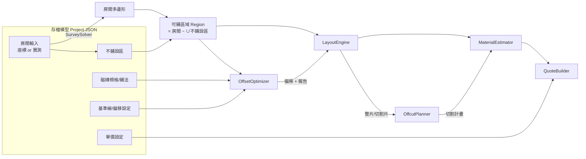

# TilePlan 系統分析與架構設計（v1.0）

> 狀態：已依此設計完成開發。開發中修正的設計以「（實作修正）」標註，原因寫在該段。

## 0. 決策紀錄

| # | 決策 | 理由 |
|---|---|---|
| D1 | 同一磁磚跨房間合併片數後才換算箱數（無條件進位） | 一次叫貨同批號、避免色差，且總箱數不會因每間各自進位而偏多 |
| D2 | 工資以顯示的兩位小數坪數計算 | 業主可用報價單上的數字自行驗算 |
| D3 | 基準線只定方向，兩軸偏移自由最佳化 | 最容易同時滿足對稱與 ≥ 1/3 |
| D4 | 黏著劑、填縫劑依包裝計價，包數無條件進位 | 符合實際叫貨方式 |
| D5 | Target net10.0 | 本機僅 .NET 10 SDK；LTS；符合「.NET 9 以上」 |
| D6 | 「1/3 磚寬」= 磚在垂直於該牆方向的尺寸 × 1/3 | 切條的寬度是沿這個方向量的 |
| D7 | 餘料旋轉預設 0°/180°，刀口預設 0 | 不翻面（釉面在上）；手動切磚機刀口可忽略 |
| D8 | 不預先啟用 AOT，量測後再決定 | 避免 CI 多裝 wasm-tools workload |

---

## 1. 需求分析

### 1.1 使用者與情境

| 角色 | 情境 | 痛點 |
|---|---|---|
| 師傅（現場） | 用捲尺量牆長、對角線 | 老公寓牆不直角，紙筆畫不準 |
| 師傅／老闆（回去後） | 排版、算叫幾箱磚、報價 | 叫太多浪費、叫太少要補貨，補到的批號顏色不同 |
| 業主 | 看報價單 | 要能列印、看得懂、數字能對得起來 |

**核心價值**：從「實測數據」到「可以下單的箱數」和「可以給業主的報價」，中間每一步都要可以追溯、可以驗證。

### 1.2 功能分解

```
專案 (Project)
 ├─ 房間 (Room) ×N
 │   ├─ 形狀輸入：座標繪製 ｜ 牆長 + 對角線實測
 │   ├─ 不鋪設區 ×M（多邊形）
 │   ├─ 磁磚規格 + 鋪法（正排／交丁 1/2、1/3／45° 斜貼）
 │   ├─ 基準線 + 偏移（自動／手動）
 │   └─ 計算結果（衍生資料，不存檔）
 │        ├─ 排版：整片／切割片（附形狀）
 │        ├─ 偏移報告：牆邊條寬、是否達標、原因
 │        ├─ 切割計畫：原磚 → 切成哪幾塊 → 用在哪
 │        └─ 材料：片數、箱數、黏著劑、填縫劑
 ├─ 磁磚目錄（房間引用）
 ├─ 單價設定（黏著劑、填縫劑、各鋪法工資）
 └─ 報價單（由各房間結果彙總）
```

### 1.3 驗收標準對照

| # | 驗收項目 | 負責模組 | 驗證方式 |
|---|---|---|---|
| 1 | `dotnet run`、線上 Demo | Web、CI | README + GitHub Pages |
| 2 | 6.00 m² / 1.82 坪 / 5.64 m² | Geometry | 單元測試 |
| 3 | L 形實測還原，誤差 < 0.5 cm | Survey | 單元測試 |
| 4 | 缺對角線時不假設直角 | Survey（剛性分析） | 單元測試 |
| 5 | 30×60 正排手算 | Layout | 單元測試 |
| 6 | 交丁、45° 手算 | Layout | 單元測試 |
| 7 | 牆邊條寬 ≥ 1/3，做不到要說明 | Offset | 單元測試 |
| 8 | 面積守恆，200+ 隨機房間 | Layout | 性質測試 |
| 9 | 餘料重用不增加整片，且確實放得下 | Cutting | 單元 + 性質測試 |
| 10 | 箱數／黏著劑／填縫劑手算 | Estimation | 單元測試 |
| 11 | 1,200 片磚改縫寬 < 1 秒 | Layout + Web | 瀏覽器內量測 |
| 12 | 報價單一致、A4 列印 | Quoting + Web | 單元測試 + 列印預覽截圖 |
| 13 | JSON 往返結果相同、重新整理後還在 | Projects + Web | 單元測試（+ bUnit） |
| 14 | ≥ 40 個測試全數通過 | 全部 | CI |

---

## 2. 系統架構

### 2.1 方案結構

```
TilePlan/
├─ TilePlan.slnx
├─ src/
│  ├─ TilePlan.Core/              ← class library，不依賴 Blazor；唯一外部套件：Clipper2
│  │  ├─ Geometry/                Vec2、Polygon、Region、PolygonOps（Clipper 轉接層）、Units
│  │  ├─ Survey/                  實測 → 形狀：RigidityAnalyzer、SurveySolver
│  │  ├─ Tiles/                   TileSpec、Pattern、Lattice（磚格座標系）
│  │  ├─ Layout/                  LayoutEngine、CellClassifier、Piece、LayoutResult
│  │  ├─ Offset/                  OffsetOptimizer、EdgeStripEvaluator、OffsetReport
│  │  ├─ Cutting/                 OffcutPlanner、CutPlan、StockTile
│  │  ├─ Estimation/              MaterialEstimator
│  │  ├─ Quoting/                 QuoteBuilder、Quote
│  │  └─ Projects/                Project、Room（存檔模型）、ProjectSerializer、ProjectCalculator（facade）
│  └─ TilePlan.Web/               ← Blazor WebAssembly standalone
│     ├─ Pages/                   Home（專案與房間）、RoomEditor、QuotePage
│     ├─ Components/              PolygonEditor、SurveyForm、TileSpecForm、LayoutCanvas、
│     │                           PieceInspector、CutListView、QuoteTable
│     ├─ Services/                ProjectStore、AutoSaveService、BrowserStorage、FileTransfer
│     └─ wwwroot/                 js/panzoom.js、js/storage.js、css/print.css、samples/
├─ tests/
│  ├─ TilePlan.Core.Tests/        ← xUnit（主力）
│  └─ TilePlan.Web.Tests/         ← bUnit（少量：自動儲存還原、面積顯示）
├─ samples/                       ← 範例專案 JSON（浴室、廚房、L 形客廳）
├─ docs/
└─ .github/workflows/             ← ci.yml（build + test）、deploy.yml（GitHub Pages）
```

依賴方向：`Web → Core`，`Core.Tests → Core`，`Web.Tests → Web`。Core 不知道 UI 的存在。

### 2.2 資料流



**設計原則**：

- **存檔模型只存「輸入」**，所有結果都是輸入的純函數（`ProjectCalculator.Compute(project)`）。這讓驗收 13「匯出再匯入結果完全相同」變成一個「決定性（determinism）」問題，而不是「把結果也存進去再比對」。
- 決定性要求：不用亂數、不依賴 `Dictionary`/`HashSet` 的列舉順序、所有排序都是穩定排序且有明確的 tie-break。
- UI 端以「房間輸入的指紋」快取每間房的計算結果，改 A 房間不會重算 B 房間。

### 2.3 技術選型

| 項目 | 選擇 | 理由 |
|---|---|---|
| Target framework | **net10.0** | 本機只有 .NET 10 SDK；10 是 LTS，符合「.NET 9 以上」 |
| UI | Blazor WASM standalone | 題目指定 |
| 多邊形布林運算 | **Clipper2**（NuGet `Clipper2`，Boost 授權） | 題目允許；整數座標版本（Clipper64）運算穩健 |
| 序列化 | System.Text.Json | 內建；double 預設以最短可往返格式輸出，往返不失真 |
| localStorage | 自寫約 20 行 JS interop | 不引入 Blazored.LocalStorage 等套件 |
| 平移縮放 | 自寫小 JS 模組，直接改 SVG `viewBox` | 拖曳時不經過 .NET 重繪，1,200 片磚也順 |
| 測試 | xUnit；bUnit（少量） | 題目指定 |
| 部署 | GitHub Pages + GitHub Actions | 免費、題目建議 |

新引入的套件只有 **Clipper2、xUnit、bUnit**（後兩者僅測試專案）。

---

## 3. 領域模型

### 3.1 單位與精度

- 所有長度在領域層以 **公分（double）** 表示，與使用者輸入一致。
- 進出 Clipper2 時轉成整數：**1 單位 = 1 µm**（每公分 × 10,000）。原本設計為 0.01 mm（實作修正：RectClip 求交點有 ±1 單位誤差，一片 60 cm 的磚會差到 0.03 cm²）。100 m 的房間也只有 10⁸，遠低於 Clipper2 的 ±4.6×10¹⁸。
- 排版裁切在磚格座標中進行（實作修正）：磚在磚格座標中是對齊座標軸的長方形，只有房間需要旋轉一次，避免旋轉後的磚頂點整數化造成相鄰磚重疊。
- 縫寬、厚度輸入是 mm，在 `TileSpec` 建構時統一轉成 cm，之後不再出現 mm。
- **片數、箱數、金額一律用 `decimal`**。原因：`100 * 1.05` 在 double 是 `105.00000000000001`，無條件進位會變成 106 片——這正好是驗收 10 會踩到的坑，會寫成測試。
- 面積換算：m² = cm² / 10,000；坪 = m² × 121 / 400。顯示用 `MidpointRounding.AwayFromZero` 四捨五入到小數兩位。

### 3.2 存檔模型（Project JSON）

```jsonc
{
  "schemaVersion": 1,
  "name": "王公館 浴室+廚房",
  "tiles": [
    { "id": "t1", "name": "霧面 30×60", "lengthCm": 60, "widthCm": 30,
      "thicknessMm": 9, "jointMm": 2, "piecesPerBox": 8, "pricePerBox": 980 }
  ],
  "pricing": {
    "adhesiveKgPerM2": 5, "adhesiveKgPerBag": 20, "adhesivePricePerBag": 280,
    "groutDensityKgPerM3": 1600, "groutKgPerBag": 2, "groutPricePerBag": 150,
    "laborPerPing": { "straight": 3500, "runningBond": 3800, "diagonal": 4500 },
    "defaultWasteRate": { "straight": 0.05, "runningBond": 0.05, "diagonal": 0.10 }
  },
  "rooms": [
    {
      "id": "r1", "name": "浴室",
      "shape": { "kind": "polygon", "vertices": [[0,0],[300,0],[300,200],[0,200]] },
      // 或 { "kind": "survey", "walls": [300,200,300,200], "diagonals": [{"from":0,"to":2,"length":360.56}] }
      "exclusions": [ { "name": "柱子", "vertices": [[0,0],[60,0],[60,60],[0,60]] } ],
      "tileId": "t1",
      "pattern": { "kind": "runningBond", "bondRatio": "1/2", "longSideAlongBaseline": true },
      "baseline": { "origin": [150, 0], "angleDeg": 90, "anchor": "jointOnLine" },
      "offset": { "mode": "auto" },          // 或 { "mode": "manual", "u": 12.3, "v": 4.5 }
      "reuseOffcuts": true,
      "wasteRateOverride": null
    }
  ]
}
```

- `schemaVersion` 讓之後改格式時可以寫遷移。
- 實測輸入存的是**原始量測值**，不是算出來的座標——之後修正某個量測，形狀會重算。

### 3.3 計算結果（不存檔）

```
RoomResult
 ├─ Polygon             房間多邊形（實測已解出）
 ├─ SurveyReport?       實測模式才有：殘差、缺少的量測
 ├─ Region              可鋪區域（房間 − 不鋪設區）
 ├─ Area                { Cm2, M2, Ping }
 ├─ Layout              Pieces[]: { Id, Cell(i,j), Kind: Full|Cut, Shape(多邊形 1..n), TileLocalShape }
 ├─ OffsetReport        { U, V, MinStripWidth, Threshold, Satisfied, WallStrips[], Reasons[] }
 ├─ CutPlan             StockTiles[]: { No, Cuts: [{ PieceId, Placement, IsFromOffcut }] }
 └─ Materials           { FullTiles, StockForCuts, TilesWithWaste, Boxes, AdhesiveKg, GroutKg, JointLengthCm }
```

---

## 4. 核心演算法

### 4.1 實測牆長 + 對角線 → 房間形狀（Survey）

**問題本質**：n 邊形在平面上（扣掉平移、旋轉）有 2n − 3 個自由度。n 面牆長提供 n 個限制，還差 **n − 3 個獨立量測**（對角線）才能讓形狀「剛性」（rigid）。

- 長方形（n = 4）：只量四面牆 → 缺 1 條。這就是驗收 4：四面牆長相同的平行四邊形有無限多個，系統必須拒絕，而不是假設直角。
- L 形（n = 6）：缺 3 條對角線。

**輸入慣例**：牆依序編號 A→B→C…，沿房間**逆時針**走（房間在左手邊）；第一面牆 AB 放在 +x 軸、A 在原點。UI 提供「我是順時針量的」切換，內部轉成逆時針。

**演算法（三階段）**：

1. **剛性分析（RigidityAnalyzer）**
   把量測（牆 + 對角線）當成「桿件」，在隨機的一般位置（generic configuration）組出剛性矩陣（rigidity matrix），算秩（rank）。
   - rank = 2n − 3 → 剛性，可以解。
   - rank < 2n − 3 → 缺 `2n − 3 − rank` 條量測。用貪婪法從未量測的頂點對中挑出能提高秩的對角線，**建議師傅去量哪幾條**（例如「缺少 1 條對角線：請量 A–C 或 B–D」）。
   - 用固定種子的亂數產生一般位置，結果可重現。

2. **構造解（逐點三邊定位）**
   依序放置頂點：每次找一個「已和兩個已放置頂點有量測距離」的未放置點，用兩圓交點求位置。兩圓交點有鏡像兩解，用以下規則選：
   - 每一步保留兩個候選，做深度優先搜尋＋剪枝；
   - 最終解必須是**簡單多邊形（不自交）**、**逆時針方向**，且**每條量測的對角線都在房間內部**（捲尺不能穿牆）。
   - 若最後有多個合法解 → 回報「形狀有歧義，請再量一條對角線」。
   - 三角不等式不成立（量錯）→ 直接回報哪一組量測矛盾。

3. **最小平方修正（Gauss-Newton / Levenberg–Marquardt）**
   量測有多餘時（例如多量了一條對角線），以第 2 步結果為初始值，最小化 Σ(|pᵢ − pⱼ| − dᵢⱼ)²，回報每條量測的殘差。最大殘差超過 1 cm 時警告「量測可能有誤」。

> 選擇構造法 + 最小平方，而不是只用最小平方：最小平方從錯誤初始值出發會掉進「翻轉」的局部最小值，構造法先把拓樸（哪一側）確定下來。

**已知限制**：對角線只能接頂點與頂點；「牆中間某一點」的量測需要額外的共線限制，第一版不支援。

### 4.2 磚格座標系（Lattice）

以基準線建立磚格座標 (u, v)：原點 = 基準線上的點，u 軸 = 基準線方向（45° 斜貼時再轉 45°）。

設模數 mᵤ = 磚長 + 縫、mᵥ = 磚寬 + 縫（`longSideAlongBaseline = false` 時對調），偏移 (oᵤ, oᵥ) ∈ [0, mᵤ) × [0, mᵥ)：

| 鋪法 | 第 (i, j) 片磚的左下角 |
|---|---|
| 正排 | (oᵤ + i·mᵤ, oᵥ + j·mᵥ) |
| 交丁 r（1/2、1/3） | (oᵤ + i·mᵤ + frac(j·r)·mᵤ, oᵥ + j·mᵥ) |
| 45° 斜貼 | 正排，但座標系旋轉 45° |

「基準線錨點」決定偏移 0 的意義：`jointOnLine`（縫對齊基準線）或 `centerOnLine`（磚中心對齊基準線）。

### 4.3 排版與分類（LayoutEngine）

可鋪區域 R = 房間 − ∪不鋪設區（Clipper 差集，算一次）。

**效能關鍵：不要對每一片磚都做 Clipper 運算。**

1. 在磚格座標中把 R 的每條邊「光柵化」到磚格上（沿著邊走，標記經過的格子及其鄰格）→ 這些是**邊界格**，通常只佔總數的一小部分。
2. 非邊界格不會被任何邊穿過，所以不是「整片在內」就是「整片在外」，用格子中心的 point-in-polygon 判定即可 → **整片**。
3. 只有邊界格做 `tile ∩ R` → 0 塊（丟棄）、1 塊或多塊（例如被柱子切成兩半）→ **切割片**，附切割後形狀與尺寸。

400×300 cm、10×10 cm 磚：約 1,200 片中邊界格約 150 片，Clipper 運算量降一個數量級。

**縫的處理**：

- 縫網路 J = 各條縫帶（寬 g 的長條）的聯集 ∩ R，**與磚片分開獨立產生**。
- 縫總長度 = 縫的中心線裁切到 R 內的長度（Clipper open path 裁切），給填縫劑公式用。
- 假設：切割片切齊牆面，牆邊不另留縫（實務上由踢腳板／矽利康收邊）。列入已知限制。

### 4.4 自動偏移調整（OffsetOptimizer）

**目標（字典序，前者優先）**：

1. 所有「可達成的牆」的邊條寬 ≥ 門檻（磚在該方向尺寸的 1/3）
2. 平行對牆的邊條寬盡量相等（左右對稱）：最小化 Σ|w_左 − w_右|
3. 跨牆的磚越少越好（實作修正：300 cm 牆配 60 cm 磚時，兩側 29.5 與兩側 59.6 都對稱且達標，後者少一欄切割片）
4. 無法達成的牆，盡量提高其最小寬度
5. Tie-break：偏移最接近基準線錨點

「可達成」的判定：第一輪把所有牆都納入，記錄每面牆在所有候選中看過的最佳寬度；最佳寬度仍不足門檻的牆，第二輪改列入第 4 項。

基準線只決定磚格方向，兩軸偏移都由最佳化自由決定（決策 D3）；使用者可切換為手動偏移。

**「牆邊條寬」的定義**（一般多邊形也成立）：與某面牆共用一段邊的切割片，其頂點到該牆的**最大垂直距離**（切片深度）。對於與磚縫平行的牆，它就是傳統的「邊條寬」；對於斜牆，它能抓出三角形小碎片。

**轉角片**（實作修正）：同時貼著兩面不平行牆的切片，形狀由兩面牆共同決定（45° 斜貼的牆角幾乎一定是小三角形），牆上還有其他切片時不計入；整面牆都只有轉角片時（例如 114 cm 寬的房間配 64 cm 磚只放得下兩欄）才用轉角片的深度，避免整面牆漏量。快速評估器與精確報告使用同一個定義，否則最佳化會以為達標、報告卻顯示不足。

**快速評估器（EdgeStripEvaluator）**：最佳化時要評估上百個候選偏移，每次都做完整排版太慢。評估時把每面牆近似為**半平面**，只取跨牆的磚，用一次半平面裁切（Sutherland–Hodgman，純算術、無配置）算切片深度。選定偏移後再用精確排版重新驗證，**回報的是精確值**。

**候選偏移**：
- 解析候選：正排／交丁時，平行於 v 軸的牆只受 oᵤ 影響（反之亦然），可以直接算出「對稱點」和「剛好等於門檻」的位置；
- 網格取樣：5×5 粗網格，再沿搜尋方向做 24 點線搜尋 + 局部細化，最多 3 輪；平行於磚縫的牆沿 u、v 軸搜尋，斜牆（含 45° 斜貼）沿兩條對角方向搜尋；
- 基準線錨點本身。

**做不到時的原因判定**：

| 原因代碼 | 判定方式 | 畫面說明範例 |
|---|---|---|
| `ObliqueWall` | 牆與磚縫夾角不是 0°/90°（斜貼時不是 45°） | 「斜牆 C–D 與磚縫夾 17°，必然產生三角形小片，最小 3.2 cm」 |
| `ThirdBond` | 交丁 1/3 時同一面牆各列切條相差 1/3 磚長 | 「交丁 1/3：左牆各列切條為 a、a+⅓、a+⅔，兩側無法同時 ≥ 1/3」 |
| `ConflictingWalls` | 單獨看每面牆都能達成，合在一起不行 | 「L 形的牆 B–C 與 E–F 要求的偏移互相衝突」 |
| `TooNarrow` | 兩面平行牆的距離小於 4/3 磚長且非整片 | 「走道寬 35 cm，不足以避免小於 10 cm 的切條」 |

註：正排在長方形房間「一定做得到」——若剩餘量 r < 2t，改成少放一整排，兩側各 (r + m)/2 ≥ m/2 > m/3。所以測試「做不到」的案例要用交丁 1/3、斜牆或 L 形。

### 4.5 餘料重用與切割計畫（OffcutPlanner）

每片切割片都要從一片「原磚」上取下。把切割片轉回**磚的局部座標**（rotate back），問題變成：把一堆多邊形放進若干張 W×H 的原磚裡，使用的原磚越少越好（2D 裝箱問題的變形）。

**貪婪演算法（Best-Fit Decreasing）**：

```
切割片依面積由大到小排序（同面積依 Id，確保決定性）
可用餘料清單 = []
for 每片切割片 p:
    在所有餘料 × 允許旋轉角度 × 候選平移 中，找「放得進去」且「剩餘最少」的位置
    if 找到: 從該餘料切下 p，剩下的部分（可能多塊）放回餘料清單
    else:    開一片新原磚，把 p 放在原本的位置（自然位置），磚的其餘部分成為新餘料
```

- **放得進去**的判定：`area(p' − offcut) < ε`（p' 為平移旋轉後的切割片），用 Clipper 差集。
- **候選平移**：讓 p 的某個頂點對齊餘料的某個頂點（多邊形頂點數通常 ≤ 8，候選數很少）。
- **允許旋轉**：預設 0°、180°（不翻面，因為釉面在上）；90°/270° 為選項（決策 D7）。
- **最小可用餘料**：面積或寬度太小的碎料直接捨棄，避免清單膨脹。
- **刀口（kerf）**：預設 0（手動切磚機刀口可忽略），可設定；> 0 時用 Clipper offset 放大切割片（決策 D7）。

**保證（驗收 9）**：關閉重用時每片切割片各用一片新磚；開啟時只會「用餘料取代新磚」，所以整片數必然不增加。測試同時驗證每一次重用的 `p' ⊆ offcut`，且同一片原磚上切出的各塊互不重疊。

**切割清單**：原磚編號 S01、S02…；每片原磚列出切出的切割片（編號 P001…、在房間中的格位、尺寸、切割形狀），並以小 SVG 畫出在原磚上的位置。

### 4.6 材料估算（MaterialEstimator）

```
基礎片數   N₀ = 整片數 + 切割用原磚數（已扣除重用）
含損耗片數 N  = ceil(N₀ × (1 + 損耗率))           ← decimal 運算
箱數       B  = ceil(N / 每箱片數)
黏著劑 kg     = 可鋪面積(m²) × 每 m² 用量(kg)
填縫劑體積 m³ = 縫總長(m) × 縫寬(m) × 磚厚(m)
填縫劑 kg     = 體積 × 密度(kg/m³)
黏著劑包數   = ceil(黏著劑 kg / 每包 kg)            ← 依包裝計價（決策 D4）
填縫劑包數   = ceil(填縫劑 kg / 每包 kg)
```

損耗率預設：正排、交丁 5%，斜貼 10%，每間房可覆寫。

每間房各自算出含損耗片數 N；**箱數在報價層依磁磚種類跨房間合併後才進位**（決策 D1）。

### 4.7 報價（QuoteBuilder）

```
每間房：面積(m²、坪)、磁磚含損耗片數、黏著劑 kg、填縫劑 kg
        工資 = round(坪數, 2) × 該鋪法每坪單價          ← 用顯示的兩位小數坪數（決策 D2）
磁磚：  依磁磚種類合併各房間片數 → 箱數 = ceil(Σ片數 / 每箱片數) → 金額 = 箱數 × 每箱單價（決策 D1）
耗材：  黏著劑、填縫劑依整個專案合併 kg → 包數無條件進位 → 金額 = 包數 × 每包單價（決策 D4）
總價  = Σ 材料費 + Σ 工資
金額四捨五入到元；總價 = 各行金額加總（不是先加總再四捨五入），保證報價單上的數字自己加得起來。
```

報價單分兩區：**各房間明細**（面積、片數、kg、工資）與**叫貨彙總**（各磁磚箱數、耗材包數、材料費），彙總區的每個數字都能由明細區加總驗證。

---

## 5. 前端設計

### 5.1 頁面

| 路由 | 內容 |
|---|---|
| `/` | 專案：房間列表、磁磚目錄、單價設定、匯入／匯出 JSON、載入範例 |
| `/room/{id}` | 分頁：①形狀（繪製／實測）②不鋪設區 ③磁磚與鋪法 ④排版結果 ⑤切割清單 |
| `/quote` | 報價單（A4 列印版面） |

### 5.2 關鍵元件

- **PolygonEditor**：SVG 畫布，點擊加點、拖曳頂點、格點吸附（1/5/10 cm）、Shift 鎖水平垂直；旁邊有座標表格可直接輸入數字。
- **SurveyForm**：牆長表格（A–B、B–C…）+ 對角線列表（選兩個頂點 + 長度）；即時顯示剛性狀態（✅ 可解 / ⚠ 缺 N 條，建議量 X–Y）、預覽形狀、殘差。
- **LayoutCanvas**：整片／切割片／使用餘料的切割片三種顏色；基準線可拖曳；滾輪縮放、拖曳平移（JS 直接改 viewBox）；點磚 → PieceInspector 顯示尺寸、切割形狀、切割清單編號。偏移報告顯示在畫布上方（未達標時列出原因與實際最小寬度）。
- **QuotePage**：`@page { size: A4 portrait; margin: 15mm }`、`thead { display: table-header-group }`（跨頁重複表頭）、`tr { break-inside: avoid }`；中文字型用系統字型堆疊（`"Microsoft JhengHei", "PingFang TC", "Noto Sans TC", sans-serif`），不依賴網路字型。

### 5.3 狀態與儲存

- `ProjectStore`（singleton）：持有目前的 Project，提供修改方法並發出變更事件。
- `AutoSaveService`：訂閱變更，debounce 500 ms 後寫入 localStorage；啟動時還原。透過 `IBrowserStorage` 介面注入，測試時換成記憶體實作。
- 匯出：產生 JSON → JS 觸發下載；匯入：`<InputFile>` 讀檔 → 反序列化 → 驗證 schemaVersion。

---

## 6. 效能策略（驗收 11）

| 步驟 | 對策 |
|---|---|
| 排版 | 邊界格才做 Clipper（§4.3） |
| 偏移最佳化 | 半平面快速評估 + 解析候選（§4.4） |
| 餘料重用 | 候選平移數量小；碎料下限避免清單膨脹 |
| 重繪 | 磚片 SVG 放在獨立元件，只在排版結果變動時重繪；平移縮放不觸發 Blazor 重繪 |
| 量測 | UI 內建「效能量測」：改縫寬 → `Stopwatch`（計算）+ `OnAfterRenderAsync` 後 JS `performance.now()`（重繪），各跑 10 次取中位數，結果寫進 README |
| 備案 | 若 Release 版（WASM interpreter + jiterpreter）仍超過 1 秒，再評估 AOT 編譯（需要 wasm-tools workload，CI 也要裝） |
| 結果 | 未使用 AOT 即達標：正排中位數 270 ms、45° 斜貼 575 ms（見 README）。過程中的三項最佳化：偏移評估改用陣列並快取、轉角檢查只做在牆兩端、餘料配置記住失敗組合並以凸多邊形頂點判定取代 Clipper |

---

## 7. 測試策略

目標 60 個以上，至少 40 個（驗收 14）。

| 測試類別 | 主要案例 | 預估數量 |
|---|---|---|
| GeometryTests | 鞋帶公式、坪換算、四捨五入、差集面積、不鋪設區超出房間 | 8 |
| SurveyTests | 長方形+對角線、L 形已知座標（驗收 3）、缺對角線（驗收 4）、三角不等式矛盾、多餘量測殘差、鏡像歧義、順時針輸入 | 9 |
| LayoutTests | 30×60 正排手算（驗收 5）、交丁 1/2 與 1/3 手算、45° 手算（驗收 6）、不鋪設區切成兩塊、基準線旋轉 | 9 |
| OffsetTests | 長方形對稱、≥ 1/3 達成、交丁 1/3 做不到並回報原因與最小寬度、斜牆、L 形衝突（驗收 7） | 7 |
| PropertyTests | 200+ 隨機房間（固定種子）：面積守恆、磚片互不重疊、磚片在區域內（驗收 8）；重用不增加整片（驗收 9） | 5 |
| CuttingTests | 兩側邊條共用一片磚（手算）、每次重用的包含關係（驗收 9）、旋轉限制、碎料下限 | 6 |
| EstimationTests | 箱數無條件進位、decimal 陷阱（105 片）、黏著劑、填縫劑手算（驗收 10） | 6 |
| QuoteTests | 多房間不同磁磚、工資依鋪法、總價 = 各行加總（驗收 12） | 5 |
| ProjectTests | JSON 往返後排版與報價完全相同（驗收 13）、schemaVersion、範例專案可載入 | 5 |
| Web（bUnit） | 自動儲存後重新載入能還原（驗收 13）、面積顯示格式 | 3 |

**性質測試設計（驗收 8）**：

- 隨機房間產生器（固定種子）三種類型輪流：直角多邊形（L、U、T 形）、星形多邊形（隨機半徑、排序角度 → 保證不自交）、含斜牆的凸多邊形。
- 每個房間隨機放 0–2 個不鋪設區、隨機磁磚尺寸／縫寬／鋪法／基準線角度／偏移。
- 檢查：|Σ磚片面積 + 縫面積 − 可鋪面積| / 可鋪面積 < 0.1%。
- 縫面積由**獨立產生的縫網路**計算（§4.3），不是「可鋪面積 − 磚片面積」，否則測試會變成恆等式、什麼都驗不到。

**手算案例（驗收 5）**：30×60 磚、縫 2 mm、300×200 房間、長邊沿 x 軸。
- 偏移 0（從牆角開始）：x 方向 4 片整磚 + 59.2 cm 切條；y 方向 6 排 + 18.8 cm 切條 → 整片 24、切割 11。
- 自動偏移：x 方向兩側各 59.6 cm（300 = 2a + 3×60 + 4×0.2，比兩側各 29.5 少一欄切割片）；y 方向若放 6 排則 b = 9.3 cm < 10 cm（1/3 門檻），改放 5 排 → b = 24.4 cm → 整片 15、切割 20。
- 手動偏移讓左右各切 29.5 cm 時，兩條可從同一片 60 cm 磚切出（餘 30.5 ≥ 29.5），作為餘料重用的手算案例（22 片切割片只需 15 片原磚）。

---

## 8. 開發里程碑

每個里程碑結束時都能編譯、測試全過、可 commit。

| # | 內容 | 驗收 |
|---|---|---|
| M0 | Repo、方案骨架、CI、空白 Blazor 部署到 Pages | 1（部分） |
| M1 | Geometry + Clipper 轉接 + 面積 | 2 |
| M2 | Survey：剛性分析、構造解、最小平方 | 3、4 |
| M3 | Lattice + LayoutEngine + 性質測試 | 5、6、8 |
| M4 | OffsetOptimizer | 7 |
| M5 | OffcutPlanner + 切割清單 | 9 |
| M6 | MaterialEstimator + QuoteBuilder | 10、12（數字） |
| M7 | Project 模型、JSON、自動儲存 | 13 |
| M8 | UI：形狀編輯、實測、排版畫布、切割清單、報價單列印 | 12（列印） |
| M9 | 效能量測、範例專案、README、截圖、正式部署 | 1、11 |

---

## 9. 已知限制（預計寫進 README）

- 只處理地坪；不處理壁磚、轉角收邊、洩水坡度。
- 對角線只能接頂點到頂點。
- 切割片切齊牆面，牆邊不留縫。
- 餘料重用是貪婪啟發式，不保證全域最少片數。
- 斜牆與磚縫不平行時，三角形小片在數學上無法避免，只能回報。
- 只支援桌機 Chrome／Edge 滑鼠操作。
