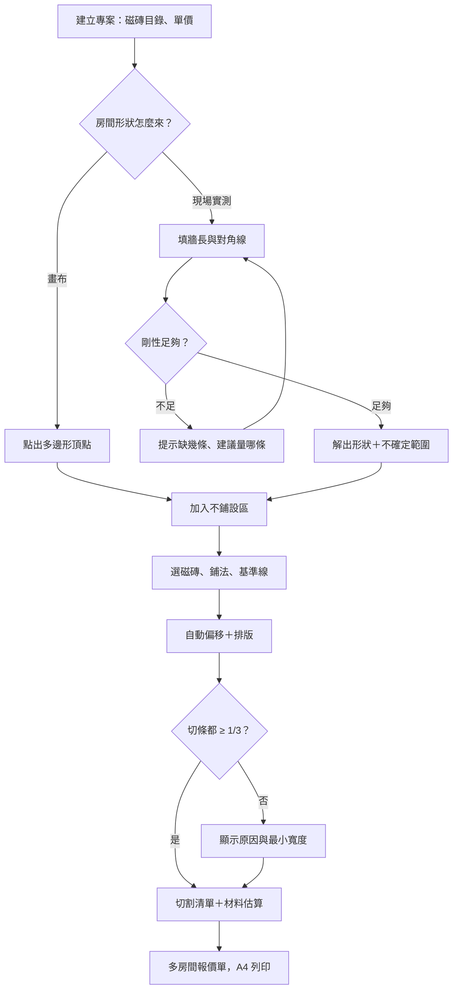
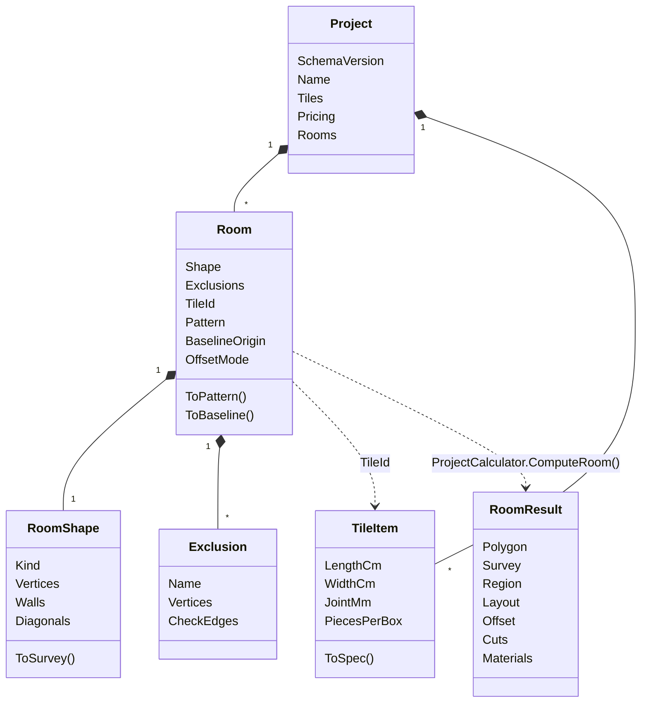
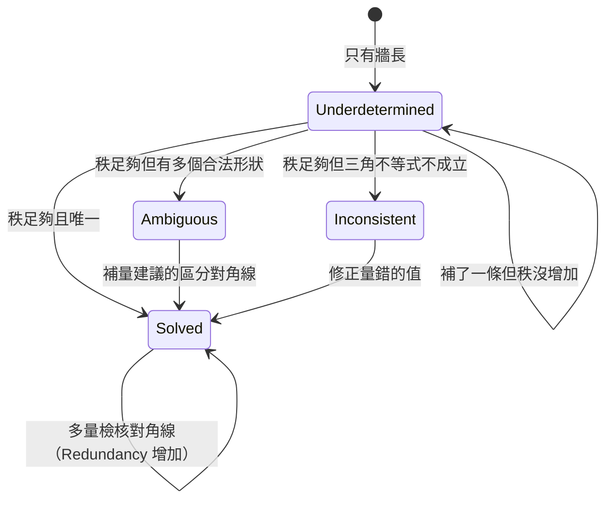

# 02 系統分析

這一章說明需求如何被拆解成系統行為：使用者怎麼走、系統裡有哪些概念、它們之間的關係。

## 主要業務流程

這張圖看的是「一間房從量測到報價」經過哪些步驟，以及哪裡會卡住。介面上的五個分頁（`src/TilePlan.Web/Pages/RoomPage.razor` 的 `Steps`）就是照這個順序排的。

重點：做不到 1/3 **不會擋住流程**。題目要求的是「說明原因與實際最小寬度」，所以 L 會接回 M，由師傅自己決定要不要接受或改基準線。

## 核心使用情境

### 情境一：老公寓 L 形客廳的現場實測

- **前置條件**：師傅帶著捲尺在現場，房間是 L 形，牆角不一定是直角。
- **主要步驟**：
  1. 在「房間形狀」分頁切到「輸入現場實測」，沿逆時針依序填 6 面牆長。
  2. 系統顯示「缺少 3 條量測」並建議對角線（例如 A–C、A–D、A–E），每條附「加入」按鈕。
  3. 填完 3 條對角線，系統解出形狀，在預覽圖每個角畫出不確定範圍的虛線圓，並建議再量一條檢核對角線與它的預期範圍。
  4. 師傅量了檢核對角線，若落在範圍內就放心；超出範圍代表前面有量錯。
- **例外**：
  - 三條量測不滿足三角不等式 → 回報是哪幾條矛盾、差了幾公分（`SurveyStatus.Inconsistent`）。
  - 對角線的角落記錯 → 主要解看起來合理但不是現場；畫面下方會列出「其他可能形狀」縮圖，可一鍵採用（FR-15）。

### 情境二：廚房 45° 斜貼，扣掉廚具底座

- **前置條件**：房間形狀已完成。
- **主要步驟**：加入廚具底座（長方形不鋪設區）→ 選 60 × 60 拋光磚、45° 斜貼 → 系統自動偏移，使牆邊與廚具前緣的切條都盡量 ≥ 20 cm。
- **例外**：牆與廚具前緣對偏移的要求互相衝突 → 報告列出「牆 A–B 與 廚具底座 第 1 邊 對偏移的要求互相衝突」，畫面以紅線標出切條不足的邊。範例專案 `samples/sample-project.json` 的廚房就是這個情況。

### 情境三：多房間報價

- **前置條件**：浴室、廚房、客廳都已排版完成，浴室與客廳可能共用同一種磚。
- **主要步驟**：開啟報價單 → 系統依磁磚種類跨房間合併片數再換算箱數（D1）、耗材合併後進位成包數（D4）、各房間工資依鋪法與兩位小數坪數計算（D2）→ 瀏覽器列印為 A4 直向。
- **例外**：某間房無法計算（例如實測缺對角線）→ 該間不列入報價（`ProjectCalculator.BuildQuote()` 只取 `r.Ok` 的房間）。

## 領域模型

這張圖分成兩半：左邊是**存檔模型**（使用者的輸入，可變類別），右邊是**計算結果**（不存檔，由輸入算出的不可變 record）。這個切法是整個系統最重要的設計決策，見 03 章。

計算結果內部的主要型別：

| 型別 | 位置 | 意義 |
|---|---|---|
| `Polygon`、`Region` | `src/TilePlan.Core/Geometry/` | 房間多邊形；可鋪區域（外框逆時針、洞順時針） |
| `SurveyResult` | `src/TilePlan.Core/Survey/SurveyModels.cs` | 實測解：狀態、多邊形、殘差、多餘量測數、不確定範圍、其他可能形狀 |
| `Lattice` | `src/TilePlan.Core/Tiles/Lattice.cs` | 磚格座標系：方向、模數、偏移、交丁週期 |
| `LayoutResult`、`Piece` | `src/TilePlan.Core/Layout/` | 每片磚的格位 (I, J)、整片／切割、鋪設形狀與在原磚上的形狀 |
| `OffsetReport`、`WallStrip` | `src/TilePlan.Core/Offset/OffsetModels.cs` | 每面牆／每條不鋪設區邊緣的切條寬度與門檻 |
| `CutPlan`、`StockTile`、`CutAssignment` | `src/TilePlan.Core/Cutting/CutPlan.cs` | 原磚 S01、S02…各切出哪些切割片 |
| `RoomMaterials` | `src/TilePlan.Core/Estimation/MaterialEstimator.cs` | 片數、含損耗片數、黏著劑、縫長、填縫劑 |
| `Quote` | `src/TilePlan.Core/Quoting/QuoteBuilder.cs` | 房間明細、磁磚叫貨、耗材三區 |

注意 `Room` 透過 `TileId` 字串引用磁磚，而不是直接持有 `TileItem`。這讓多間房共用同一種磚、改一次單價全部生效，也讓 JSON 存檔不會重複磁磚資料。

## 狀態轉換：實測推算的結果

系統中有明確狀態的是實測推算（`SurveyStatus`，`src/TilePlan.Core/Survey/SurveyModels.cs`）。這張圖看的是「使用者每多填一條量測，結果可能往哪裡走」。

`Solved` 內部還有一個重要的子狀態：`Redundancy == 0`（剛好夠用，無法檢核）與 `Redundancy > 0`（可以用殘差檢核）。介面依這個值決定顯示「無法檢查是否量錯」還是「最大殘差 x cm」，見 08 章。

## 需求追溯表

從需求直接跳到程式碼。路徑都相對於 repo 根目錄。

| 需求 | 主要實作 | 主要測試 |
|---|---|---|
| FR-01 畫布繪製 | `src/TilePlan.Web/Components/ShapeStep.razor`、`src/TilePlan.Web/Components/Canvas.razor`、`src/TilePlan.Web/wwwroot/js/tileplan.js` | E2E（開啟範例流程） |
| FR-02、FR-03 實測推算 | `src/TilePlan.Core/Survey/SurveySolver.cs`、`src/TilePlan.Core/Survey/RigidityAnalyzer.cs`、`src/TilePlan.Core/Survey/LeastSquares.cs` | `tests/TilePlan.Core.Tests/Survey/SurveySolverTests.cs` |
| FR-04 不鋪設區 | `src/TilePlan.Core/Geometry/Region.cs`（`Region.Tileable()`）、`src/TilePlan.Web/Components/ExclusionStep.razor` | `tests/TilePlan.Core.Tests/Geometry/AreaTests.cs` |
| FR-05 面積 | `src/TilePlan.Core/Geometry/Area.cs`、`src/TilePlan.Web/Components/AreaText.razor` | `AreaTests`、`tests/TilePlan.Web.Tests/ComponentTests.cs` |
| FR-06、FR-07 磁磚與鋪法 | `src/TilePlan.Core/Tiles/TileSpec.cs`、`src/TilePlan.Core/Tiles/Pattern.cs`、`src/TilePlan.Core/Tiles/Lattice.cs` | `tests/TilePlan.Core.Tests/Layout/LayoutEngineTests.cs` |
| FR-08 排版 | `src/TilePlan.Core/Layout/LayoutEngine.cs` | `LayoutEngineTests`、`tests/TilePlan.Core.Tests/Layout/LayoutPropertyTests.cs` |
| FR-09 自動偏移 | `src/TilePlan.Core/Offset/OffsetOptimizer.cs`、`src/TilePlan.Core/Offset/EdgeStripEvaluator.cs`、`src/TilePlan.Core/Offset/Wall.cs` | `tests/TilePlan.Core.Tests/Offset/OffsetOptimizerTests.cs` |
| FR-10 餘料與切割清單 | `src/TilePlan.Core/Cutting/OffcutPlanner.cs`、`src/TilePlan.Web/Components/CutListStep.razor` | `tests/TilePlan.Core.Tests/Cutting/OffcutPlannerTests.cs`、`OffcutPropertyTests.cs` |
| FR-11 材料估算 | `src/TilePlan.Core/Estimation/MaterialEstimator.cs` | `tests/TilePlan.Core.Tests/Estimation/MaterialEstimatorTests.cs` |
| FR-12 視覺化 | `src/TilePlan.Web/Components/LayoutStep.razor`、`src/TilePlan.Web/Components/PieceInspector.razor`、`src/TilePlan.Web/Rendering/Svg.cs` | E2E |
| FR-13 報價單 | `src/TilePlan.Core/Quoting/QuoteBuilder.cs`、`src/TilePlan.Web/Pages/QuotePage.razor`、`src/TilePlan.Web/wwwroot/css/app.css`（列印樣式） | `tests/TilePlan.Core.Tests/Quoting/QuoteBuilderTests.cs`、E2E 列印測試 |
| FR-14 匯出匯入、自動儲存 | `src/TilePlan.Core/Projects/ProjectSerializer.cs`、`src/TilePlan.Web/Services/AutoSaveService.cs`、`src/TilePlan.Web/Pages/Home.razor` | `tests/TilePlan.Core.Tests/Projects/ProjectTests.cs`、`tests/TilePlan.Web.Tests/AutoSaveTests.cs` |
| FR-15 其他可能形狀 | `SurveySolver` 的 `AlternativeShapes()`、`src/TilePlan.Web/Components/SurveyForm.razor` | `SurveySolverTests` 的 `Mislabelled_diagonals_keep_the_real_room_among_the_alternatives` |
| FR-16 不確定範圍 | `src/TilePlan.Core/Survey/Uncertainty.cs`、`LeastSquares.InverseNormalMatrix()` | `tests/TilePlan.Core.Tests/Survey/SurveyUncertaintyTests.cs`、`tests/TilePlan.Web.Tests/SurveyFormTests.cs` |
| FR-17 不鋪設區邊緣 | `Wall.ExclusionEdges()`（`src/TilePlan.Core/Offset/Wall.cs`） | `tests/TilePlan.Core.Tests/Offset/ExclusionEdgeTests.cs` |
| FR-18 細碎片 | `src/TilePlan.Core/Layout/PieceGeometry.cs`、`LayoutResult.SmallPieces()` | `tests/TilePlan.Core.Tests/Layout/SmallPieceTests.cs` |
| NFR-04 效能 | `LayoutStep.razor` 的 `Benchmark()`、`samples/perf-400x300.json` | E2E `Changing_joint_width_relayouts_to_the_core_result`（< 3 秒的寬鬆上限） |
| NFR-05 面積守恆 | `src/TilePlan.Core/Layout/JointNetwork.cs` | `LayoutPropertyTests`、`tests/verification/verify.cs` |
