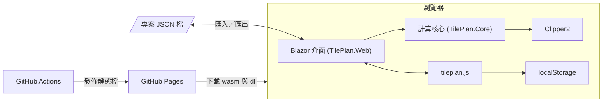
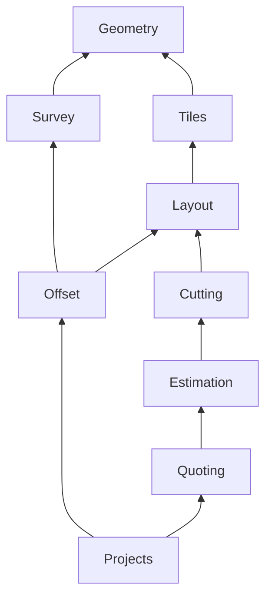

# 03 架構設計

這一章說明系統怎麼被切開、各部分怎麼合作。一句話總結：**一個純函數的計算核心，外面包一層很薄的 Blazor 介面**。

## 整體架構

這張圖看的是「哪些東西在瀏覽器裡、哪些在外面」。答案是：執行期全部在瀏覽器裡，外面只有開發與部署的基礎設施。



沒有後端、沒有資料庫。

> 📄 依據：題目要求「Blazor WASM 獨立應用」，並明列不需要資料庫與 Docker

這帶來兩個後果：
- 所有計算（包含 1,200 片磚的排版與偏移搜尋）都在使用者的瀏覽器裡跑，效能要求（NFR-04）直接落在 WebAssembly 直譯器上。
- 儲存只有 localStorage 與手動匯出的檔案，所以「匯出再匯入結果完全相同」必須靠**決定性計算**保證，而不是靠資料庫。

## 分層與職責

| 層 | 專案 | 職責 | 不做的事 |
|---|---|---|---|
| 介面層 | `src/TilePlan.Web` | 頁面、元件、SVG 繪圖、使用者輸入、自動儲存、JS interop | 不做任何幾何或金額計算 |
| 核心層 | `src/TilePlan.Core` | 幾何、實測推算、排版、偏移、餘料、材料、報價、存檔模型與序列化 | 不知道 Blazor、DOM、localStorage 的存在 |
| 外部套件 | Clipper2 | 多邊形布林運算（差集、聯集、交集、矩形裁切、擴張） | 不負責排版策略（題目限制 NFR-03） |

> 📄 依據：題目要求核心邏輯放在獨立 class library；測試報告第 7 節以「`TilePlan.Core.csproj` 只參考 Clipper2」與「`Clipper2Lib` 只出現在 `src/TilePlan.Core/Geometry/PolygonOps.cs`」驗證這兩條限制

核心層內部再依領域切成九個資料夾（namespace），依賴方向是單向的：



（圖中省略了大家都依賴的 `Geometry` 與 `Tiles` 的箭頭。）沒有循環依賴。唯一看起來奇怪的是 `Offset → Survey`：`Wall.Of()` 用 `SurveySolver.LabelPair()` 產生「A–B」這種牆名。

🔍 推斷：這是為了讓排版報告與實測表單用同一套牆名，但代價是偏移模組多依賴了一個不相干的模組。把 `Label()`／`LabelPair()` 搬到 `Geometry` 或獨立的 `Labels` 類別會更乾淨。

## 目錄結構導覽

```
TilePlan/
├── TilePlan.slnx                 方案檔（新版 XML 格式）；刻意不含 E2E 測試專案
├── Directory.Build.props         全部專案共用：Nullable、警告視為錯誤、InvariantGlobalization
├── global.json                   鎖定 SDK 10.0.100 以上
├── src/
│   ├── TilePlan.Core/            純 C# class library，唯一外部套件是 Clipper2
│   │   ├── Geometry/             Vec2、Polygon、Region、Area；PolygonOps 是 Clipper 的唯一入口
│   │   ├── Survey/               牆長＋對角線 → 房間形狀；剛性分析、最小平方、誤差傳播
│   │   ├── Tiles/                TileSpec、Pattern、Baseline、Lattice（磚格座標系）
│   │   ├── Layout/               LayoutEngine 排版、Piece、縫網路、細碎片最小寬度
│   │   ├── Offset/               自動偏移最佳化與切條報告
│   │   ├── Cutting/              餘料重用（OffcutPlanner）與切割計畫
│   │   ├── Estimation/           片數、箱數、黏著劑、填縫劑
│   │   ├── Quoting/              單價設定與報價單
│   │   └── Projects/             存檔模型、JSON 序列化、ProjectCalculator（整條流程的入口）
│   └── TilePlan.Web/             Blazor WebAssembly standalone
│       ├── Pages/                Home（專案）、RoomPage（五個分頁）、QuotePage（報價單）
│       ├── Components/           每個分頁一個元件，加上 Canvas、PieceInspector 等共用元件
│       ├── Services/             ProjectStore、AutoSaveService、BrowserStorage、範例專案
│       ├── Rendering/            幾何 → SVG path 字串、數字格式
│       └── wwwroot/              index.html、app.css（含列印樣式）、tileplan.js
├── tests/
│   ├── TilePlan.Core.Tests/      xUnit：手算、單元、性質測試（97 個）
│   ├── TilePlan.Web.Tests/       xUnit + bUnit：自動儲存、元件顯示（10 個）
│   ├── TilePlan.E2E.Tests/       Playwright for .NET：以發佈版跑瀏覽器流程（5 個）
│   └── verification/verify.cs    單檔 C# 腳本：用不同種子獨立驗證
├── samples/                      範例專案與效能測試專案（同時內嵌進 Web 組件）
└── .github/workflows/            ci.yml、deploy.yml
```

## 最重要的設計決策：輸入是狀態，結果是函數

> 📄 依據：`docs/architecture.md` §2.2「存檔模型只存輸入，所有結果都是輸入的純函數」

`Project`、`Room`、`TileItem` 這些存檔模型只保存使用者的輸入。排版、切割、材料、報價全部由 `ProjectCalculator.Compute(project)`（`src/TilePlan.Core/Projects/ProjectCalculator.cs`）算出，不存檔。

這個決定把三個看似不同的需求變成同一件事：

| 需求 | 如果把結果也存檔 | 只存輸入 |
|---|---|---|
| 匯出再匯入結果相同（驗收 13） | 要比對存下來的結果與重算的結果，兩者可能不一致 | 只要計算是決定性的就自動成立 |
| 改一個量測值，形狀要跟著變 | 要記得讓舊結果失效 | 天生成立：實測模式存的是原始量測，不是座標 |
| 程式升級後演算法變好 | 舊檔案留著舊結果 | 重新開啟就是新結果 |

代價是：每次開啟都要重算；而且**決定性**成為硬性要求。程式裡因此處處可見這類寫法：

- `RigidityAnalyzer` 的「隨機一般位置」用固定種子 `20261024`。
- `OffcutPlanner.Plan()` 排序切割片時 `OrderByDescending(p => Math.Round(p.Area, 6)).ThenBy(p => p.CutNo)`，面積相同時有明確的 tie-break。
- `ProjectSerializer` 依賴 System.Text.Json 對 `double` 的「最短可往返」輸出，匯出再匯入的數值逐位元相同。

## 使用到的設計模式

| 模式 | 在哪裡 | 為什麼用 | 不用會怎樣 |
|---|---|---|---|
| Facade | `ProjectCalculator` | 介面只要呼叫一個方法就能得到一間房的全部結果；E2E 測試也直接用它算期望值 | 每個元件各自串接 Survey → Layout → Offset → Cutting，容易順序不一致 |
| Adapter（轉接層） | `PolygonOps` | Clipper 用整數座標（`Path64`），領域層用公分 `double`；單位換算與正規化集中在一處 | Clipper 型別滲透到整個核心，換單位（後來從 0.01 mm 改成 1 µm）要改很多地方 |
| 結果物件取代例外 | `RoomResult.Error`、`SurveyResult.Status` | 「缺一條對角線」是正常狀態，不是程式錯誤；介面要顯示原因而不是當掉 | 介面到處 try/catch，或使用者看到 Blazor 的錯誤橫幅 |
| Observer | `ProjectStore.Changed` 事件 | 任何元件修改專案後通知一次，自動儲存與頁面重繪都訂閱它 | 每個修改點都要記得呼叫儲存 |
| Memoization | `ProjectStore.Result()`（以 `ProjectSerializer.RoomKey()` 為鍵）、`OffsetOptimizer` 內 `Search` 的 `_memo` | 改 A 房間不重算 B 房間；同一個偏移不評估兩次 | 每次重繪都重算所有房間，三間房就是三倍時間 |
| 測試接縫（Seam） | `IBrowserStorage` 介面，正式用 `LocalStorage`、測試用 `tests/TilePlan.Web.Tests/MemoryStorage.cs` | 自動儲存的邏輯可以在沒有瀏覽器的情況下測試，包含「儲存很慢時」的情境 | 只能靠 E2E 測，慢且難以製造時序 |
| 延遲載入 | `TilePlanJs.Module()`（`src/TilePlan.Web/Services/BrowserStorage.cs`） | JS 模組只 `import` 一次並共用 | 每個元件各自 import，或用全域函式污染 `window` |

## 橫切關注點

| 關注點 | 做法 |
|---|---|
| 錯誤處理 | 核心層對**程式誤用**丟 `ArgumentException`（例如 `TileSpec.Validate()`、`SurveySolver` 的 `BuildBars()`）；`ProjectCalculator.ComputeRoom()` 把它們接住轉成 `RoomResult.Error`，介面顯示訊息。專案檔格式錯誤丟 `ProjectFormatException`，由匯入與自動還原處理。錯誤訊息全部是給師傅看的中文句子，並指出是哪一面牆、哪一條對角線 |
| 驗證 | 輸入驗證集中在核心：`TileSpec.Validate()`、`ProjectSerializer.Deserialize()` 的版本檢查、`SurveySolver` 的頂點索引檢查。介面只做最基本的「不是數字就忽略」 |
| 設定 | 沒有 `appsettings`。業務參數（單價、損耗率、黏著劑用量、填縫劑密度）放在 `Pricing`，跟著專案檔走，因為每個案子可能不同 |
| 日誌 | 沒有。這是純前端工具，錯誤直接顯示在畫面上 |
| 授權與交易 | 不適用：沒有登入、沒有伺服器端狀態 |
| 單位 | 領域層長度一律公分 `double`；縫寬與厚度只在 `TileSpec` 以 mm 輸入，屬性 `JointCm`／`ThicknessCm` 轉換後就不再出現 mm；進出 Clipper 時乘以 `PolygonOps.Scale`（10,000，即 1 µm）；片數、箱數、金額一律 `decimal` |
| 編譯品質 | `Directory.Build.props` 開啟 `TreatWarningsAsErrors` 與 `Nullable`，所有專案共用 |

## 設計稿與實作的差異

`docs/architecture.md` 是開發前寫的設計稿，部分名稱在實作時改了。讀那份文件時以這張表對照：

| 設計稿的名稱 | 實際的程式碼 |
|---|---|
| `CellClassifier` | 併入 `LayoutEngine`（`BoundaryCells()`、`CrossesOpenRect()`） |
| `StockTile` 放在獨立檔案 | `src/TilePlan.Core/Cutting/CutPlan.cs` 內的 record |
| `RoomEditor` 頁面 | `src/TilePlan.Web/Pages/RoomPage.razor` |
| `PolygonEditor`、`LayoutCanvas`、`CutListView`、`TileSpecForm` | `ShapeStep`、`LayoutStep`、`CutListStep`、`TileStep`，共用 `Canvas` |
| js/panzoom.js、js/storage.js（設計稿名稱） | 合併為 `src/TilePlan.Web/wwwroot/js/tileplan.js` |
| css/print.css（設計稿名稱） | 列印樣式在 `src/TilePlan.Web/wwwroot/css/app.css` 的 `@media print` 區塊 |
| `FileTransfer` 服務 | `Home.razor` 直接呼叫 JS 的 `downloadText` 與 Blazor 的 `InputFile` |
| 快速評估用 Sutherland–Hodgman 裁切 | `EdgeStripEvaluator` 改成只算磚的四個角到牆線的距離，不需要裁切（見 08 章） |
| 存檔 JSON 的 `pattern` 是物件、`offset` 是物件 | 實際是扁平欄位：`pattern`、`bond`、`offsetMode`、`offsetU`、`offsetV`（見 06 章） |
