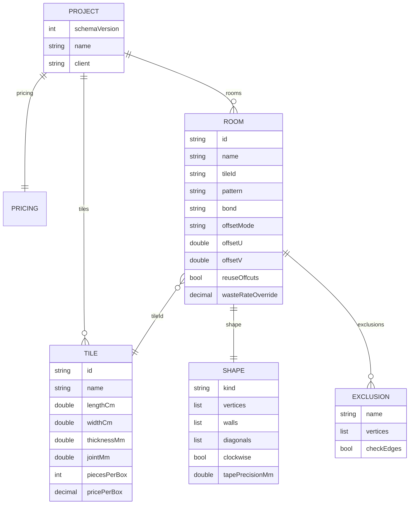
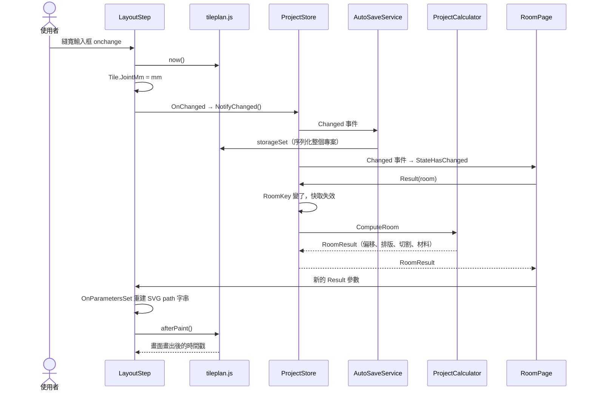
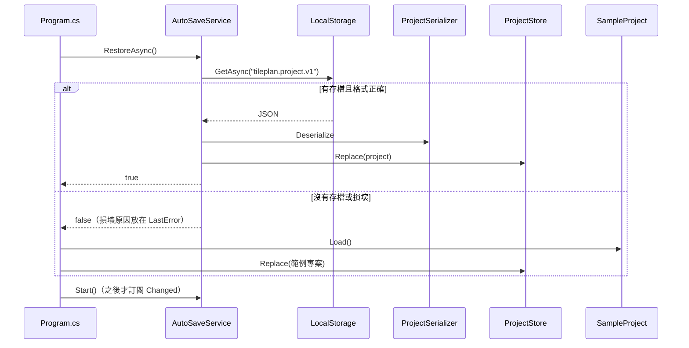
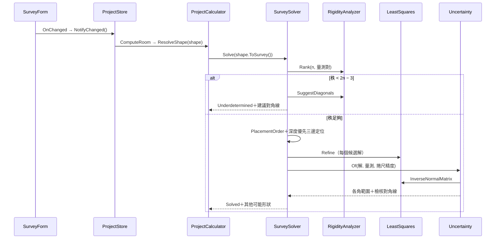
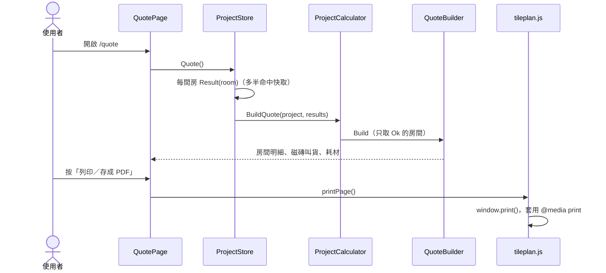

# 06 輸入／輸出介面與資料流

TilePlan 沒有 HTTP API。這一章改寫系統對外與對內的介面：專案檔格式（同時取代 05 章資料庫設計）、核心層對介面層公開的 API、.NET 與 JavaScript 之間的 interop，以及四條核心流程的時序圖。

## 頁面路由

| 路由 | 頁面 | 內容 |
|---|---|---|
| `/` | `src/TilePlan.Web/Pages/Home.razor` | 專案名稱與業主、房間列表、磁磚目錄、單價與材料參數、匯入／匯出、載入範例 |
| `/room/{Id}` | `src/TilePlan.Web/Pages/RoomPage.razor` | 五個分頁：房間形狀、不鋪設區、磁磚與鋪法、排版結果、切割清單 |
| `/quote` | `src/TilePlan.Web/Pages/QuotePage.razor` | 報價單（A4 列印版面）；無法計算的房間另外列出原因 |
| 其他 | `src/TilePlan.Web/Pages/NotFound.razor` | 由 `App.razor` 的 `NotFoundPage` 指定 |

## 專案檔格式（JSON）

匯出的檔案、localStorage 中的自動存檔、`samples/` 的範例，三者是**同一種格式**，都由 `ProjectSerializer`（`src/TilePlan.Core/Projects/ProjectSerializer.cs`）讀寫。屬性名稱是 C# 屬性轉 camelCase，列舉值也是 camelCase 字串。

### 結構



（`ROOM` 另有 `longSideAlongBaseline`、`baselineOrigin`、`baselineAngleDeg`、`allowQuarterTurns`、`kerfMm`；`PRICING` 有 12 個欄位，見 `src/TilePlan.Core/Quoting/Pricing.cs`。）

### 範例（節錄自 `samples/sample-project.json` 的 L 形客廳）

```json
{
  "id": "living",
  "name": "L 形客廳",
  "shape": {
    "kind": "survey",
    "vertices": [],
    "walls": [520.0, 280.0, 190.0, 140.0, 330.0, 420.0],
    "diagonals": [
      { "from": 0, "to": 2, "length": 590.6 },
      { "from": 0, "to": 3, "length": 432.8 },
      { "from": 0, "to": 4, "length": 534.1 }
    ],
    "clockwise": false
  },
  "exclusions": [ { "name": "柱子", "vertices": [ { "x": 330, "y": 240 }, "..." ] } ],
  "tileId": "wood",
  "pattern": "runningBond",
  "bond": "third",
  "offsetMode": "auto"
}
```

### 格式設計的重點

1. **實測模式存原始量測，不存解出的座標。** `shape.kind` 為 `survey` 時 `vertices` 是空的。之後修正某條量測，形狀會重算；換了更好的求解器，舊檔案也自動受益。
2. **`schemaVersion` 是唯一的版本機制。** `Deserialize()` 拒絕比 `Project.CurrentSchemaVersion` 新的檔案（「請更新程式」），也拒絕沒有版本的檔案。
3. **新增欄位不必升版。** 上面的範例沒有 `checkEdges` 與 `tapePrecisionMm`，因為範例檔是在這兩個功能出現前寫的。讀入時欄位不存在，就保留 C# 屬性初始值：`Exclusion.CheckEdges = true`、`RoomShape.TapePrecisionMm = 5`。這正是「舊專案檔預設開啟不鋪設區邊緣檢查」（決策 D10）的實作方式，不需要任何遷移程式碼。
4. **中文不跳脫。** `JavaScriptEncoder.UnsafeRelaxedJsonEscaping` 讓專案檔裡的「浴室」不會變成 `浴室`，師傅用記事本打開也看得懂。
5. **`double` 往返不失真。** System.Text.Json 以最短可往返格式輸出 `double`，所以 `ProjectTests` 的 `Serialization_round_trip_is_stable_text` 可以要求「序列化 → 反序列化 → 再序列化」的文字完全相同。

### 瀏覽器儲存

| 項目 | 值 |
|---|---|
| 儲存位置 | `localStorage` |
| 鍵 | `tileplan.project.v1`（`AutoSaveService.StorageKey`） |
| 內容 | 與匯出檔相同的 JSON |
| 寫入時機 | 每次 `ProjectStore.Changed` 立即寫入；寫入進行中又有修改，結束後再寫一次最新狀態 |
| 讀取時機 | 啟動時（`Program.cs`）；沒有存檔或存檔損壞就載入範例專案 |

## 核心層的公開 API

介面層只透過這幾個入口使用核心層。測試也大量使用同樣的入口，所以 E2E 測試可以用 `ProjectCalculator.Compute()` 算出期望值，再去比對畫面。

| 方法 | 位置 | 輸入 → 輸出 |
|---|---|---|
| `ProjectCalculator.Compute(project)` | `src/TilePlan.Core/Projects/ProjectCalculator.cs` | 整個專案 → 每間房的 `RoomResult` 與 `Quote` |
| `ProjectCalculator.ComputeRoom(project, room)` | 同上 | 一間房 → `RoomResult`（失敗時 `Error` 有原因） |
| `ProjectCalculator.BuildQuote(project, rooms)` | 同上 | 已算好的房間結果 → `Quote`；只納入 `Ok` 的房間 |
| `ProjectCalculator.ResolveShape(shape)` | 同上 | 座標或實測 → 多邊形與 `SurveyResult` |
| `ProjectSerializer.Serialize()`／`Deserialize()` | `src/TilePlan.Core/Projects/ProjectSerializer.cs` | `Project` ⇄ JSON 字串；格式錯誤丟 `ProjectFormatException` |
| `ProjectSerializer.RoomKey(project, room)` | 同上 | 一間房的快取鍵：房間 + 它用的磁磚 + 單價設定的壓縮 JSON |

`RoomResult` 的欄位依計算順序排列，前面的步驟失敗時後面的欄位是 `null`：

```csharp
// src/TilePlan.Core/Projects/ProjectCalculator.cs
public sealed record RoomResult(
    Room Room, string? Error,
    Polygon? Polygon, SurveyResult? Survey, Region? Region, TileSpec? Tile,
    LayoutResult? Layout, OffsetReport? Offset, CutPlan? Cuts, RoomMaterials? Materials)
{
    public bool Ok => Error is null;
    // ...
}
```

這個設計讓「實測缺對角線」時，形狀分頁仍然拿得到 `Survey`（顯示缺哪條），排版分頁則看到 `Error`（顯示「無法排版：缺少 1 條量測……」）。同一個結果物件，各分頁取自己需要的部分。

## .NET 與 JavaScript 的介面

> 📄 依據：`src/TilePlan.Web/wwwroot/js/tileplan.js` 開頭的註解「只處理 .NET 不擅長的高頻事件（平移縮放、拖曳），計算一律回到 .NET」

**.NET 呼叫 JS**（透過 `TilePlanJs.Module()` 取得的模組）：

| 函式 | 用途 | 呼叫端 |
|---|---|---|
| `storageGet`／`storageSet`／`storageRemove` | localStorage 讀寫；`get` 與 `remove` 吞掉例外（無痕模式），`set` 讓例外傳回 .NET | `LocalStorage` |
| `downloadText(fileName, text, mime)` | 用 Blob URL 觸發下載 | `Home.razor` 的 `Export()` |
| `printPage()` | `window.print()` | `QuotePage.razor` |
| `now()`、`afterPaint()` | `performance.now()`；等兩個 `requestAnimationFrame` 後回傳時間戳 | `LayoutStep.razor` 的效能量測 |
| `initCanvas(svg, dotnet)`、`fitView(...)`、`disposeCanvas(svg)` | 綁定滾輪縮放、拖曳平移、頂點拖曳 | `Canvas.razor` |

**JS 呼叫 .NET**（`Canvas.razor` 上的 `[JSInvokable]` 方法）：

| 方法 | 時機 | 參數 |
|---|---|---|
| `OnCanvasClick` | 按下又放開、移動不到 4 px | 世界座標（cm）與點到的 `data-handle` |
| `OnHandleDrag` | 拖曳有 `data-handle` 的元素時，每個 animation frame 最多一次 | handle 名稱與世界座標 |
| `OnHandleDrop` | 放開拖曳中的 handle | 同上 |

平移與縮放**完全不回到 .NET**：JS 直接改 `<svg>` 的 `viewBox` 屬性。Blazor 不知道 viewBox 變了，所以也不會重繪 1,200 片磚。這是驗收 11 能過的關鍵之一。

## 核心流程一：修改縫寬到畫面更新（驗收 11）

這張圖看的是效能預算花在哪裡。量測從修改前的 `now()` 開始，到 `afterPaint()` 回傳為止。



注意 `ProjectCalculator.ComputeRoom()` 是在**重繪時**才被呼叫（`RoomPage.razor` 的 markup 裡 `var result = Store.Result(_room);`），而不是修改時立刻算。修改只是標記「專案變了」，真正的計算延遲到有人需要結果時，並由快取擋掉重複計算。

## 核心流程二：啟動與還原



`Start()` 刻意放在還原與載入範例**之後**：還原時的 `Replace()` 會觸發 `Changed`，若先訂閱，就會把剛讀出來的內容原封不動再寫一次（無害但多餘）；載入範例那次也不會被存起來，直到使用者第一次修改。

🔍 推斷：還原失敗時改開範例、而不是丟出錯誤，是為了讓「第一次使用」與「存檔損壞」都能直接進入可用狀態；損壞原因透過 `AutoSaveService.LastError` 顯示，而不是無聲吞掉。

## 核心流程三：實測推算形狀

`SurveyForm` 本身不呼叫求解器：使用者改了牆長或對角線，它只通知 `OnChanged`；`RoomPage` 重繪時經由 `ProjectStore.Result()` 重算，再把新的 `RoomResult` 當參數傳回 `SurveyForm`，表單讀 `Result.Survey` 顯示狀態。



細節見 08 章「實測推算」。

## 核心流程四：報價單與列印



列印版面由 CSS 決定：`@page { size: A4 portrait; margin: 12mm; }`、`thead` 跨頁重複、`tr` 不跨頁切斷、`tfoot` 改成一般列（避免「合計」在每頁都印一次）。見 `src/TilePlan.Web/wwwroot/css/app.css` 的 `@media print` 區塊與 11 章 F4。
