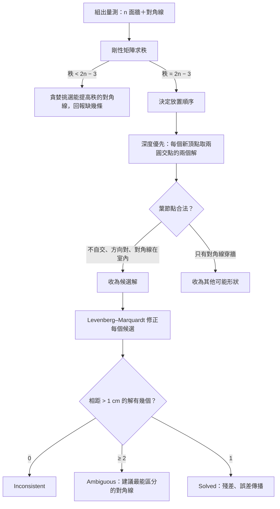
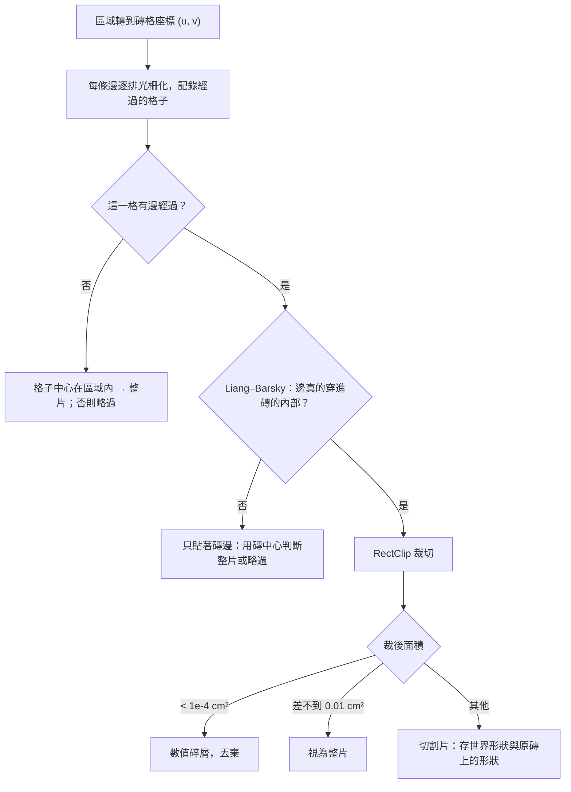
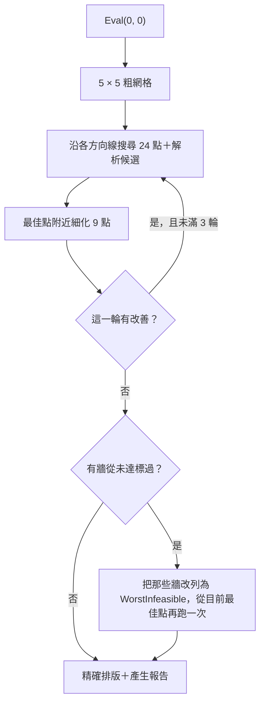

# 08 核心演算法

這個專案有六個值得拆解的演算法，依資料在管線中流動的順序排列：

1. [實測推算：牆長＋對角線 → 房間形狀](#1-實測推算牆長對角線--房間形狀)
2. [誤差傳播：量得準不準](#2-誤差傳播量得準不準)
3. [排版引擎：只裁切需要裁切的磚](#3-排版引擎只裁切需要裁切的磚)
4. [自動偏移：讓牆邊切條對稱且夠寬](#4-自動偏移讓牆邊切條對稱且夠寬)
5. [餘料重用：Best-Fit Decreasing](#5-餘料重用best-fit-decreasing)
6. [細碎片：切割片的最小寬度](#6-細碎片切割片的最小寬度)

最後一節整理[數值與捨入規則](#7-數值與捨入規則)，它們不算演算法，但每一條都對應一個真實的錯誤。

---

## 1. 實測推算：牆長＋對角線 → 房間形狀

**問題**：師傅在 L 形客廳量了 6 面牆長和 3 條對角線，要還原出房間的形狀。牆角不一定是直角，所以不能「假設長方形再修正」。

**輸入**：`SurveyInput`（牆長依序、對角線的兩端頂點與長度、量測方向、捲尺精度）。
**輸出**：`SurveyResult`（狀態、多邊形、殘差、多餘量測數、各角不確定範圍、檢核對角線、其他可能形狀）。
**實作**：`src/TilePlan.Core/Survey/SurveySolver.cs`、`RigidityAnalyzer.cs`、`LeastSquares.cs`。

### 需要幾條量測？

n 邊形有 2n 個座標，扣掉整體平移（2）與旋轉（1），還剩 **2n − 3 個自由度**。n 面牆提供 n 個限制，所以還需要 **n − 3 條對角線**。長方形要 1 條，L 形要 3 條。

但「條數夠」不代表「形狀確定」：量了 4 條都從 A 出發的對角線，可能某條是多餘的、另一個角仍然會晃。要判斷的是這組量測的**剛性**（rigidity）。

### 步驟



**第一階段：剛性分析**（`RigidityAnalyzer`）

把每條量測當成一根桿子。對頂點 i、j 之間的桿子，剛性矩陣的一列是：在 i 的 (x, y) 欄位放 pᵢ − pⱼ，在 j 的欄位放 pⱼ − pᵢ。這一列代表「這根桿子長度對各座標的微分」。矩陣的秩就是這組量測能鎖住的自由度。

```csharp
// src/TilePlan.Core/Survey/RigidityAnalyzer.cs
private static double[] Row(Vec2[] p, int i, int j)
{
    var row = new double[2 * p.Length];
    var d = p[i] - p[j];
    row[2 * i] = d.X; row[2 * i + 1] = d.Y;
    row[2 * j] = -d.X; row[2 * j + 1] = -d.Y;
    return row;
}
```

關鍵在 `GenericPositions()`：剛性是組合性質，與實際座標無關，但要在「一般位置」（generic，沒有三點共線之類的巧合）上計算才準。程式用固定種子 `20261024` 產生隨機座標。用真實房間的座標反而不行：長方形的對邊平行，會讓矩陣出現不該有的退化。

秩不足時，`SuggestDiagonals()` 從未量的頂點對中貪婪挑選：一次加一條，秩有增加才保留。候選的排序是「與既有對角線交錯越少越好、跨度越短越好」，因為交錯的對角線在 L 形裡常常穿牆，短的對角線比較好量。

**第二階段：逐點三邊定位**（`SurveySolver.PlacementOrder()` 與 `Search`）

A 放原點、B 放 +x 軸。之後每次挑一個「與已放置頂點有兩條以上量測」的頂點，用兩圓交點求位置。兩圓交點有鏡像的兩個解，兩個都試，形成一棵深度優先搜尋樹：

```csharp
// src/TilePlan.Core/Survey/SurveySolver.cs（Search.Recurse 節錄）
var step = steps[k];
var (a, ra) = step.Links[0];
var (b, rb) = step.Links[1];
foreach (var candidate in CircleIntersections(_pos[a]!.Value, ra, _pos[b]!.Value, rb, step.Vertex, a, b))
{
    if (!ConsistentWithExtraLinks(step, candidate)) continue;
    _pos[step.Vertex] = candidate;
    Recurse(k + 1);
    _pos[step.Vertex] = null;
}
```

如果這個頂點還有第三條以上的量測，`ConsistentWithExtraLinks()` 先剪枝（誤差超過 3 cm + 5% 就放棄這個分支）。

葉節點的篩選規則是這個演算法的靈魂：

| 條件 | 為什麼 |
|---|---|
| 多邊形不自交 | 房間的牆不會交叉 |
| 方向與量測方向一致 | 逆時針量（房間在左手邊）就必須是逆時針多邊形，這排除了整個圖形的鏡像 |
| 每條量測的對角線都在房間內 | 捲尺不能穿牆。L 形這類凹多邊形，正是靠這條排除「凹角翻到另一側」的解 |

第三條規則同時也是一個風險：如果師傅把對角線的角落記錯（例如把 B–E 記成 C–E），正確形狀反而會因為「對角線穿牆」被排除。所以 `Search` 把「只差在對角線穿牆」的葉節點另外收集到 `ExteriorDiagonalShapes`，最後以 `Alternatives` 回傳，畫面畫成縮圖讓使用者對照（見 11 章 F2）。

**第三階段：最小平方修正**（`LeastSquares.Refine()`）

以構造解為初始值，用 Levenberg–Marquardt 最小化 Σ(|pᵢ − pⱼ| − dᵢⱼ)²。未知數是 2n − 3 個座標（A 的 x、y 與 B 的 y 固定）。

**為什麼不直接做最小平方？**

> 📄 依據：`README.md`「先構造再修正，而不是直接做最小平方，是因為最小平方從錯誤的初始值出發，常會掉進『整個三角形翻到另一側』的局部最小值。」

距離方程式對鏡像是對稱的：一個頂點翻到牆的另一側，所有距離都不變。最小平方只會往「附近」找，無法跨過這種離散的選擇。構造法先用組合搜尋把「每個頂點在哪一側」確定下來，最小平方只負責吸收量測誤差。這是「離散問題用搜尋、連續問題用最佳化」的典型分工。

### 複雜度

| 步驟 | 複雜度 | 實際規模 |
|---|---|---|
| 求秩 | O(m · (2n)²)，m 為量測數 | n ≤ 10 時微不足道 |
| 建議對角線 | O(n² 個候選 × 求秩) | 只在量測不足時執行 |
| 深度優先搜尋 | 最壞 2ⁿ⁻² 個葉節點 | 上限 `MaxLeaves = 200_000`；L 形放 4 個頂點，最多 2⁴ = 16 個 |
| LM 修正 | 每次迭代 O(m · 16 + (2n)³)，最多 100 次 | 每個候選解各跑一次 |

### 邊界條件

| 情況 | 處理 |
|---|---|
| 兩圓差一點點沒交到 | `TangentTolerance = 1.0` cm 內視為相切（量測誤差），超過才判定三角不等式不成立 |
| 兩圓相切 | `h > 1e-6` 才產生第二個解，避免兩個幾乎相同的候選 |
| 兩個解相距 < 1 cm | `SameSolutionTolerance` 內視為同一個解 |
| 量測足夠但找不到放置順序 | 例如所有對角線都不從已放置的點出發；回報「請改量從同一個角出發的對角線」 |
| 修正後有兩個以上合法形狀 | `MostDiscriminatingPair()` 找兩個解中距離差最大的未量頂點對，建議量它 |
| 頂點索引不存在、長度 ≤ 0 | `BuildBars()` 丟 `ArgumentException`，`ProjectCalculator.ResolveShape()` 轉成錯誤訊息 |

### 替代做法

- **多維尺度法（MDS）**：需要完整的距離矩陣，現場不可能量齊。
- **只用最小平方加多個隨機起點**：對小房間可行，但無法保證找到所有合法解，也無法偵測歧義。
- **假設直角再修正**：題目明確禁止（驗收 4）。

---

## 2. 誤差傳播：量得準不準

**問題**：L 形量了剛好 3 條對角線，解出來的殘差必然是 0（方程式數等於未知數）。畫面顯示「最大殘差 0.00 cm」會讓人以為量得很準，但其實是**完全無法檢查**。

> 📄 依據：外部審查意見（對話中使用者貼上）；`docs/test-report.md` §11

**輸入**：解出的頂點、量測、捲尺精度（預設 ±5 mm，視為 95% 範圍）。
**輸出**：每個角的 95% 不確定半徑；一條建議的檢核對角線與它的預期範圍。
**實作**：`src/TilePlan.Core/Survey/Uncertainty.cs`、`LeastSquares.InverseNormalMatrix()`。

### 步驟

1. 在解上線性化：J 是每條量測長度對 2n − 3 個座標的 Jacobian（就是剛性矩陣去掉固定的三欄）。
2. 座標的共變異數 Σ = σ²(JᵀJ)⁻¹，σ = 精度 ÷ 1.96。
3. 對每個頂點取出 2 × 2 的子矩陣 [[a, b], [b, c]]，最大特徵值 λmax = (a + c)/2 + √(((a − c)/2)² + b²)。
4. 95% 信賴橢圓的長軸半徑 = √(5.991 · σ² · λmax)，5.991 是自由度 2 的卡方分布 95% 分位數。
5. 對每條「室內量得到、還沒量過」的對角線 i–j，算出它的長度變異數 gᵀΣg（g 是兩點連線方向的梯度），加上新量測本身的變異數 σ²，取 1.96 倍標準差作為預期範圍。範圍最大的那條就是建議的檢核對角線。

```csharp
// src/TilePlan.Core/Survey/Uncertainty.cs
var g = (p[i] - p[j]).Normalized();
double var = variance * Quadratic(inverse, [(LeastSquares.VarX(i), g.X), (LeastSquares.VarY(i), g.Y),
                                            (LeastSquares.VarX(j), -g.X), (LeastSquares.VarY(j), -g.Y)]);
// 比對時，新量的這一條本身也有捲尺誤差，兩者的變異數相加
double range = 1.96 * Math.Sqrt(Math.Max(0, var) + variance);
```

**為什麼挑「推算誤差最大」的那條？** 那條對角線的長度目前最不確定，代表它最依賴前面每一條量測的正確性。前面任何一條量錯，它最容易偏離預期範圍。這是實驗設計裡「在最不確定的地方取樣」的想法。

**為什麼用長軸而不是圓形近似？** 📄 決策 D9：長軸偏保守，不會低估。測試 `Predicted_95_percent_range_matches_monte_carlo` 以 2,000 次蒙地卡羅驗證，推算值比模擬的 95 百分位大約 25%（測試允許 0.9–1.35 倍）。

**成效**：測試用的 400 × 300 L 形，捲尺精度 ±5 mm 時最遠的角約 ±3.3 cm；多量建議的那一條後降到約 ±1.5 cm（📄 `README.md`）。

### 限制

線性化只在誤差小時成立。量錯好幾公分時，解本身就偏了，在偏掉的解上算出的範圍只能當參考（📄 `README.md` 已知限制）。

---

## 3. 排版引擎：只裁切需要裁切的磚

**問題**：400 × 300 cm 房間配 10 × 10 cm 磚，約 1,200 片。對每一片都做多邊形交集太慢；而且旋轉過的磚頂點整數化後，相鄰磚會互相重疊幾個單位。

**輸入**：可鋪區域 `Region`、磚格 `Lattice`。
**輸出**：`LayoutResult`：每片磚的格位、整片／切割、鋪設形狀、在原磚上的形狀、縫總長。
**實作**：`src/TilePlan.Core/Layout/LayoutEngine.cs`。

### 步驟



**第一步：轉座標系，而不是轉磚。** 在磚格座標中每片磚都是軸對齊的長方形 [u, u + TileU] × [v, v + TileV]。房間只旋轉一次，旋轉誤差只出現在房間邊界上，不會累積在每片磚上。commit `9c545af` 的說明：「避免旋轉後的磚頂點整數化造成相鄰磚重疊」。

**第二步：光柵化邊界。** `BoundaryCells()` 對每條邊逐排求出它在該排的 u 區間，記下重疊的格子與邊的索引。這和電腦圖學畫線的掃描線演算法同一個想法。

**第三步：用 Liang–Barsky 排除「只碰到」的情況。** 被光柵化標記的格子不一定真的被切。例如牆剛好落在磚縫上，邊經過這一格，但磚本身完全在內。`CrossesOpenRect()` 把磚往內縮 `Eps`，用 Liang–Barsky 參數化裁切判斷線段是否進入**開區間**的內部：

```csharp
// src/TilePlan.Core/Layout/LayoutEngine.cs
internal static bool CrossesOpenRect(Vec2 a, Vec2 b, Vec2 origin, double w, double h)
{
    double x0 = origin.X + Eps, x1 = origin.X + w - Eps, y0 = origin.Y + Eps, y1 = origin.Y + h - Eps;
    double t0 = 0, t1 = 1, dx = b.X - a.X, dy = b.Y - a.Y;
    return Clip(-dx, a.X - x0) && Clip(dx, x1 - a.X) && Clip(-dy, a.Y - y0) && Clip(dy, y1 - a.Y) && t1 - t0 > 1e-12;
    // ...
}
```

這一步讓「剛好貼齊牆的磚」被正確分類為整片，而不是面積 99.999% 的切割片。對自動偏移特別重要，因為偏移最佳化常常會選「磚邊貼齊牆」的位置。

**第四步：只對真正被穿過的磚呼叫 Clipper。** 而且用 `RectClip`（專門處理「區域 ∩ 長方形」，比一般布林運算快很多）。裁切前把磚的原點對齊整數格（`PolygonOps.Snap()`），切割片在原磚上的局部形狀才會剛好落在 [0, TileU] × [0, TileV] 內。

**縫長**：內部格子的縫長直接加 `TileV + Mu`（右側縫高 + 上方縫寬，交叉點只算一次）；邊界格的縫中心線收集起來，最後一次用 `PolygonOps.ClippedLineLength()` 裁到區域內。

### 複雜度

設 C 為格子總數、E 為區域邊數、B 為邊界格數。光柵化 O(Σ 每條邊經過的格子數) ≈ O(B)；內部判斷 O(C · E)（每格一次點在多邊形）；裁切 O(B · 區域頂點數)。

400 × 300 配 10 × 10 時，1,200 片裡只有約 140 片需要裁切（📄 `README.md`），Clipper 的呼叫次數降了一個數量級。

### 邊界條件

- 被柱子切成兩塊的磚：`RectClip` 回傳兩個多邊形，存成同一片切割片的兩部分（同一格只能切一次，兩塊來自同一片原磚）。測試：`Pillar_splitting_a_tile_yields_one_piece_with_two_parts`。
- 區域為空：直接回傳空結果。
- 縫寬為 0：不計算縫長。

### 替代做法

- **對每片磚做世界座標的 Clipper 交集**：最直接，但慢一個數量級，且有相鄰磚重疊的整數化問題。
- **整個磚格做一次布林運算**（區域 ∩ 所有磚的聯集）：Clipper 呼叫次數最少，但結果是一大塊多邊形，要再拆回每一片磚，反而更複雜。

---

## 4. 自動偏移：讓牆邊切條對稱且夠寬

**問題**：300 cm 的牆配 60 cm 的磚，從牆角開始鋪，另一邊會剩一條 59.2 cm 的切條（還好）；換成 290 cm 的牆，就只剩 49.2 cm。牆的另一側如果是 2 cm 的細條，既難切又難看。要找一個磚格偏移 (oᵤ, oᵥ)，讓所有牆邊切條都 ≥ 磚寬的 1/3，而且左右對稱。

**輸入**：房間多邊形、可鋪區域、磚格模板、要檢查的不鋪設區。
**輸出**：選定的磚格、精確排版、`OffsetReport`（每條邊的門檻、實際最小寬度、做不到的原因）。
**實作**：`src/TilePlan.Core/Offset/OffsetOptimizer.cs`、`EdgeStripEvaluator.cs`、`Wall.cs`。

### 切條寬度的定義

> 📄 依據：`README.md`、`docs/architecture.md` §4.4

**貼著某面牆的切割片，其頂點到該牆的最大距離。** 對與磚縫平行的牆，這就是傳統的「邊條寬」；對斜牆，它能抓出三角形小碎片。門檻是「磚在垂直該牆方向的尺寸 × 1/3」（決策 D6），由 `Wall.Create()` 依牆的方向（`WallAxis.AlongU`／`AlongV`／`Oblique`）決定。

**轉角片**：同時貼著兩面不平行牆的切片，形狀由兩面牆共同決定（45° 斜貼的牆角幾乎一定是小三角形）。牆上還有其他切片時不計入；整面牆都只有轉角片時才用它們。

### 評分（字典序）

```csharp
// src/TilePlan.Core/Offset/OffsetOptimizer.cs
private readonly record struct Score(double Shortfall, double Asymmetry, int Straddling, double WorstInfeasible, double AnchorDistance)
{
    public bool BetterThan(Score o)
    {
        if (Math.Abs(Shortfall - o.Shortfall) > 1e-6) return Shortfall < o.Shortfall;
        if (Math.Abs(Asymmetry - o.Asymmetry) > 0.05) return Asymmetry < o.Asymmetry;
        if (Straddling != o.Straddling) return Straddling < o.Straddling;
        if (Math.Abs(WorstInfeasible - o.WorstInfeasible) > 0.05) return WorstInfeasible > o.WorstInfeasible;
        return AnchorDistance < o.AnchorDistance - 1e-9;
    }
}
```

| 順位 | 準則 | 說明 |
|---|---|---|
| 1 | `Shortfall` | 做得到的牆，不足門檻的量總和 |
| 2 | `Asymmetry` | 互相面對的牆（`Wall.Faces()`），切條寬度差的總和 |
| 3 | `Straddling` | 跨牆的磚數 = 切割次數 |
| 4 | `WorstInfeasible` | 做不到的牆，最窄的切條（越寬越好） |
| 5 | `AnchorDistance` | 偏移離基準線錨點的距離 |

第 3 項是實作時加的（📄 `docs/architecture.md` §4.4「實作修正」）：300 cm 牆配 60 cm 磚，兩側各 29.5 cm 與兩側各 59.6 cm 都對稱且達標，後者少一欄切割片。

### 搜尋



**快速評估**（`EdgeStripEvaluator.Evaluate()`）：一次搜尋要評估數百個偏移，每次都做完整排版太慢。快速評估把每面牆近似成**半平面**，只看跨過牆線的磚，切片深度就是「磚的四個角在牆內側的最大距離」，純算術、不配置記憶體（`stackalloc`）、不呼叫 Clipper：

```csharp
// src/TilePlan.Core/Offset/EdgeStripEvaluator.cs（StraddleDepth 節錄）
Span<Vec2> c = [o, o + new Vec2(w, 0), o + new Vec2(w, h), o + new Vec2(0, h)];
Span<double> s = stackalloc double[4];
double maxS = double.NegativeInfinity, minS = double.PositiveInfinity;
for (int k = 0; k < 4; k++)
{
    s[k] = (c[k] - a).Dot(n);
    maxS = Math.Max(maxS, s[k]);
    minS = Math.Min(minS, s[k]);
}
if (maxS <= Eps || minS >= -Eps) return null;   // 整片在同一側：沒有跨牆
```

設計稿原本打算用 Sutherland–Hodgman 把磚裁成兩半再算深度；實作發現「長方形被直線切開後內側部分的最遠點」一定是原本的某個角，所以只要算四個點積。這是先想清楚「真正需要的量」就能省掉整個演算法的例子。

快速評估忽略不鋪設區對磚的遮擋，所以最後一定用**精確排版**重新量測（`ActualMinWidth()`），**報告的是精確值**。

**解析候選**（`AnalyticCandidates()`）：與磚縫平行的牆只受 oᵤ 或 oᵥ 其中一個影響，所以可以直接算出「磚邊貼齊牆」「切條剛好等於門檻」「兩面對牆的磚中心或縫在正中間」的偏移，加進線搜尋的候選點。交丁時每排的 u 方向位移不同，所以 oᵤ 的候選對每一種排位移各算一組。這讓搜尋不必靠運氣碰到這些剛好的位置。

**搜尋方向**：有平行於磚縫的牆時沿 u、v 軸搜尋；有斜牆（含 45° 斜貼）時沿兩條對角方向搜尋。斜牆的切條同時受 oᵤ 與 oᵥ 影響，沿座標軸一次只動一個變數會卡住。

**兩階段可行性**：第一輪把所有牆都納入 `Shortfall`，同時記錄每面牆在所有評估過的候選中看過的最寬切條（`_bestSeen`）。連最好的情況都不足門檻的牆，第二輪改列入第 4 項 `WorstInfeasible`。否則一面註定做不到的斜牆，會讓所有候選的 `Shortfall` 都很大，淹沒其他牆的差異。

### 做不到時的原因

`Explain()` 依序判斷：

| 判斷 | 說明範例 |
|---|---|
| 交丁 1/3 且牆沿 v 方向 | 「交丁 1/3：牆 A–F 每三排的切條寬度各差 1/3 磚長，無法同時都 ≥ 門檻」 |
| 斜牆，且單獨看也做不到 | 「斜牆 C–D 與磚縫夾 3°，沿牆必然出現三角形小片」 |
| 單獨看做得到，且有平行的其他邊 | 「牆 A–B 與 廚具底座 第 1 邊 對偏移的要求互相衝突」 |
| 手動偏移 | 「切條小於門檻，可改用自動偏移」 |
| 其他 | 「附近受轉角或其他邊緣影響」 |

**正排在長方形房間一定做得到**：剩餘量 r 不足時少放一整排，兩側各 (r + m)/2 ≥ m/2 > m/3（m 為模數）。這寫成了測試 `Straight_layout_in_random_rectangles_always_satisfies_the_threshold`，用 40 個隨機長方形驗證。所以要測「做不到」的情況，必須用交丁 1/3、斜牆或 L 形。

### 複雜度

每次評估 O(W × 每面牆跨過的磚數)。候選數約 2 + 25 + 3 輪 × 2–4 方向 × (24 + 解析候選 + 9)，加上可能的第二階段，總共數百次評估；`_memo` 以偏移（取到 10⁻⁶ cm）為鍵避免重複。這是 45° 斜貼效能的主要成本：最佳化前一次要 1.3 秒以上，加入陣列化、快取、轉角檢查只做在牆的兩端（`cornerReach`）、搜尋方向依牆的種類決定之後，降到約 0.59 秒（📄 `README.md`）。

### 替代做法

- **完整網格搜尋**：在 [0, Mu) × [0, Mv) 上取 100 × 100 點，簡單但要一萬次評估，而且仍可能錯過剛好等於門檻的位置。
- **把每面牆的條件寫成區間，求交集**：對平行於磚縫的牆是精確解（每面牆對 oᵤ 的可行區間是週期性的），但無法處理斜牆、轉角片與對稱性的取捨。程式的「解析候選」其實就是這個方法的端點，拿來餵給啟發式搜尋。

---

## 5. 餘料重用：Best-Fit Decreasing

**問題**：每片切割片都要從一片原磚上切下。房間左側切下 29.5 cm 寬的條，剩下的 30.5 cm 可以拿去做右側 29.5 cm 的條。要讓使用的原磚越少越好。這是 2D 裝箱問題（bin packing）的變形，NP-hard。

**輸入**：排版結果、`CutSettings`（是否重用、是否允許轉 90°、刀口寬）。
**輸出**：`CutPlan`：原磚 S01、S02…各切出哪些切割片、放在原磚的哪裡、是否來自餘料。
**實作**：`src/TilePlan.Core/Cutting/OffcutPlanner.cs`。

### 步驟

```
切割片依面積由大到小（同面積依 CutNo，保證決定性）
for 每片切割片 p:
    在餘料中由小到大找「放得進去」的位置：
        旋轉 0°、180°（允許時加 90°、270°）
        候選平移：外框四角對齊，以及 p 的每個頂點對齊餘料的每個頂點
    找到 → 選面積最小的餘料；同一塊中選「剩下最大塊最大」的位置
           從餘料切下 p，剩下的部分拆成連通塊放回餘料清單
    找不到 → 開新原磚，p 放在它原本在磚上的位置（切線就是排版時的裁切線）
    比「最小的待切片」還小的剩料直接丟棄
```

**為什麼由大到小？** 大片最難放，先處理；小片可以塞進大片切剩的縫隙。這是 First-Fit／Best-Fit Decreasing 的標準直覺，在一維裝箱已知最多用到最佳解的 11/9 倍加常數。

**為什麼選最小的餘料？** 把大塊餘料留給後面可能需要的切割片。

**保證**：關閉重用時每片切割片各用一片新原磚；開啟後，每片切割片要嘛用餘料、要嘛開新磚，所以原磚數只會減少或相同（驗收 9）。這個保證不依賴啟發式的好壞，是**結構上**成立的。

### 「放得進去」的判定

```csharp
// src/TilePlan.Core/Cutting/OffcutPlanner.cs
public static double FitTolerance(Region piece) => Math.Max(1e-3, 2 * piece.Perimeter / PolygonOps.Scale);
```

用 Clipper 算「切割片 − 餘料」的面積，小於容許量就算放得進去。容許量**與周長成正比**：沿周長 2 µm 寬的細縫。commit `b8ea502` 的說明：斜向切線上每一點都可能差 1 個整數單位，固定常數會在長斜邊上誤判。

**快速路徑**：餘料是單一凸多邊形時（新開原磚切一刀剩下的通常是），改用「切割片的每個頂點都在凸多邊形每條邊的左側」判定，完全不呼叫 Clipper。

### 複雜度與最佳化

最壞 O(P × O × R × T × Clipper)，P 為切割片數、O 為餘料數、R 為旋轉數、T 為候選平移數（頂點數乘積）。實際上靠三件事壓下來：

1. 外框尺寸不合就跳過（不必試平移）；
2. 凸餘料用頂點判定；
3. **失敗快取**：以 `(餘料, 形狀指紋)` 記住放不進去的組合。45° 斜貼同一種三角形會出現幾十次，只有第一次需要真的試。

### 邊界條件

- 刀口寬 > 0：切割片先用 `PolygonOps.Inflate()` 往外擴半個刀口寬再從餘料扣除。測試 `Kerf_can_prevent_a_tight_reuse` 確認剛好放得下的情況在加了刀口後放不下。
- 轉 90°：預設不允許（決策 D7：有紋路方向的磚轉 90° 會看得出來）；範例專案的廚房 60 × 60 拋光磚允許。
- 不翻面：只考慮旋轉，不考慮鏡像，因為釉面在上（決策 D7）。

### 替代做法

- **整數規劃**：可以求最佳解，但切割片的形狀是任意多邊形，建模困難，在瀏覽器裡也跑不動。
- **跨房間重用**：目前不支援（見 01 章待確認問題）。

---

## 6. 細碎片：切割片的最小寬度

**問題**：牆邊切條報告只看「貼著牆的切片」。柱子轉角、不鋪設區的斜角也可能產生 2 cm 寬的碎片，它們不屬於任何一面牆。要對每一片切割片算出「最窄的地方有多寬」。

**實作**：`src/TilePlan.Core/Layout/PieceGeometry.cs`；`LayoutResult.SmallPieces()` 以磚短邊的 1/3 為門檻篩選。

### 步驟

1. 以 Andrew monotone chain 求切割片的凸包。
2. **旋轉卡尺的定理**：凸多邊形的最小寬度方向，一定垂直於凸包的某一條邊。
3. 對凸包的每條邊，算所有凸包頂點到該邊所在直線的最大距離；所有邊中的最小值就是最小寬度。
4. 由多塊組成的切割片取最窄的一塊。

```csharp
// src/TilePlan.Core/Layout/PieceGeometry.cs
var hull = ConvexHull(poly.Vertices);
for (int i = 0; i < hull.Count; i++)
{
    var a = hull[i];
    var b = hull[(i + 1) % hull.Count];
    if (a.DistanceTo(b) < 1e-9) continue;
    double width = hull.Max(p => Math.Abs(Segment.SignedDistanceToLine(a, b, p)));
    min = Math.Min(min, width);
}
```

### 複雜度

凸包 O(k log k)。上面的寫法對每條邊掃描所有頂點，是 O(h²)，h 為凸包頂點數。真正的旋轉卡尺用雙指標可以做到 O(h)，但切割片的凸包頂點通常不超過 8 個，O(h²) 更簡單也更不容易寫錯。這裡用的是旋轉卡尺的**定理**，沒有用它的**掃描技巧**。

### 限制

用凸包計算，L 形這類凹形切片的最小寬度會被高估（L 的一隻腳只有 3 cm 寬，凸包卻是整個外框），可能漏標（📄 `README.md` 已知限制）。精確做法是對多邊形本身求「內接最大圓」或做形態學侵蝕（用 `PolygonOps.Inflate()` 往內縮 t/2，看是否消失），後者用 Clipper 就能做到。

---

## 7. 數值與捨入規則

每一條都對應一個真實的錯誤或驗收要求。

| 規則 | 位置 | 為什麼 |
|---|---|---|
| 片數、箱數、金額用 `decimal` | `MaterialEstimator`、`QuoteBuilder` | `double` 的 100 × 1.05 = 105.00000000000001，無條件進位會變 106 片。測試 `Waste_uses_decimal_so_exact_products_are_not_rounded_up` |
| 面積顯示先轉 `decimal`、捨到 9 位、再四捨五入到 2 位 | `Area.RoundForDisplay()` | 0.125 在 `double` 中可能是 0.12499999…，會捨成 0.12 |
| 包數先捨到公克再進位 | `MaterialEstimator.Bags()` | 40.0000000001 kg 不該變成多一包。測試 `Bags_ignore_floating_point_noise` |
| 工資用顯示的兩位小數坪數 | `QuoteBuilder.Build()` 用 `area.PingRounded` | 決策 D2：業主可以拿報價單上的數字驗算 |
| 總價 = 各行四捨五入後的金額加總 | `Quote.GrandTotal` | 報價單上的數字自己加得起來 |
| 切條報告：門檻進位；實際值不足時捨去、達標時進位 | `WallStrip.DisplayThreshold`、`DisplayMinWidth`、`Tenths` | 39.96 cm 顯示成 40.0，卻判定不足 40.0，會讓人以為程式錯了。決策 D11 |
| `Tenths` 的 ±1e-6 | `src/TilePlan.Core/Offset/OffsetModels.cs` | 19.999999999 應該是 20.0，不該被捨成 19.9 |
