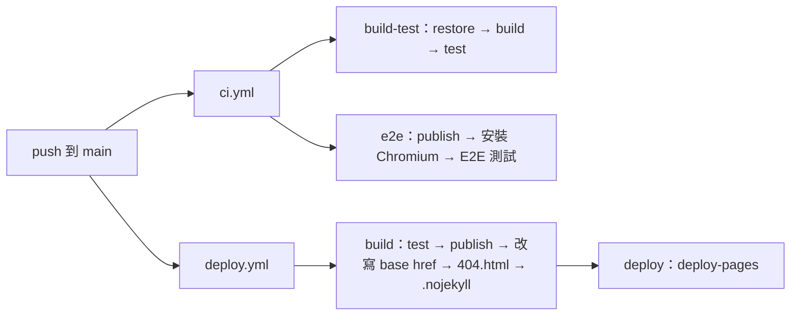

# 10 部署與環境設定

TilePlan 部署後只是一堆靜態檔（HTML、CSS、JS、`.wasm`、`.dll`），任何靜態檔主機都能放。這一章說明本機怎麼跑起來、怎麼發佈到 GitHub Pages，以及子路徑部署的三個坑。

## 環境需求

| 項目 | 版本 | 備註 |
|---|---|---|
| .NET SDK | 10.0.100 以上 | `global.json` 設 `rollForward: latestFeature`，10.0.x 的任何 feature band 都可以 |
| 瀏覽器 | 桌機版 Chrome 或 Edge | 📄 `README.md` 已知限制 |
| PowerShell（`pwsh`） | 任意 | 只有在 CI 以 `playwright.ps1 install --with-deps` 安裝 Chromium 系統套件時需要；本機跑 E2E 時 `SiteFixture` 會呼叫 `Microsoft.Playwright.Program.Main(["install", "chromium"])`，不需要 pwsh |

不需要資料庫、Docker、任何外部服務或金鑰。

## 本機啟動

```bash
git clone https://github.com/hn83320589/TilePlan.git
cd TilePlan

# 開發模式（http://localhost:5159）
dotnet run --project src/TilePlan.Web

# 量測效能時務必用 Release
dotnet run --project src/TilePlan.Web -c Release

# 全部測試
dotnet test
```

第一次開啟會載入範例專案（浴室、廚房、L 形客廳）。之後的修改自動存在瀏覽器的 localStorage；要回到乾淨狀態，在首頁按「載入範例」或「新專案」，或清除這個網站的瀏覽器資料。

連接埠來自 `src/TilePlan.Web/Properties/launchSettings.json`：`http` profile 是 5159，`https` profile 另加 7019。

## 設定項

這個專案**沒有**環境設定檔（沒有 appsettings.json、沒有 .env 檔）。所有會變動的參數都是業務參數，存在專案檔的 `pricing` 中，由使用者在首頁編輯：

| 名稱 | 用途 | 預設值 | 必填 |
|---|---|---|---|
| `adhesiveKgPerM2` | 黏著劑每平方公尺用量（kg） | 5 | 是 |
| `adhesiveKgPerBag`、`adhesivePricePerBag` | 黏著劑每包重量與單價 | 20、280 | 是 |
| `groutDensityKgPerM3` | 填縫劑乾密度 | 1600 | 是 |
| `groutKgPerBag`、`groutPricePerBag` | 填縫劑每包重量與單價 | 2、150 | 是 |
| `laborStraightPerPing`、`laborRunningBondPerPing`、`laborDiagonalPerPing` | 各鋪法每坪工資 | 3500、3800、4500 | 是 |
| `wasteStraight`、`wasteRunningBond`、`wasteDiagonal` | 各鋪法預設損耗率 | 0.05、0.05、0.10 | 是 |

預設值定義在 `src/TilePlan.Core/Quoting/Pricing.cs`。

環境變數只有一個，給 E2E 測試用：

| 名稱 | 用途 | 範例 | 必填 |
|---|---|---|---|
| `TILEPLAN_SITE` | 已發佈網站的 `wwwroot` 目錄；有設就不再自動發佈 | `<repo>/site/wwwroot` | 否 |

## CI/CD 管線

兩個 workflow 都在 push 到 `main` 時觸發。



### `ci.yml`

| job | 步驟 | 說明 |
|---|---|---|
| `build-test` | `dotnet restore` → `dotnet build -c Release` → `dotnet test --no-build -c Release` | 107 個測試；`TreatWarningsAsErrors` 讓任何警告都會讓 CI 失敗 |
| `e2e` | `dotnet publish src/TilePlan.Web -c Release -o site` → `dotnet build tests/TilePlan.E2E.Tests` → `pwsh .../playwright.ps1 install --with-deps chromium` → `dotnet test tests/TilePlan.E2E.Tests` | 以 `TILEPLAN_SITE` 指向剛發佈的 `site/wwwroot`；`--with-deps` 會安裝 Chromium 需要的系統套件，包含中文字型（列印測試需要） |

兩個 job 平行執行，互不依賴。PR 也會觸發 CI。

### `deploy.yml`

```yaml
# .github/workflows/deploy.yml（build job 節錄）
- run: dotnet test -c Release
- run: dotnet publish src/TilePlan.Web -c Release -o publish
# GitHub Pages 的網址在 /<repo>/ 子路徑底下，base href 必須跟著改
- run: sed -i 's|<base href="/" />|<base href="/${{ github.event.repository.name }}/" />|' publish/wwwroot/index.html
# SPA 直接開子路由時 Pages 會回 404，用同一份 index.html 接住
- run: cp publish/wwwroot/index.html publish/wwwroot/404.html
# 關掉 Jekyll，否則底線開頭的 _framework 目錄會被忽略
- run: touch publish/wwwroot/.nojekyll
```

部署前先跑一次測試：測試沒過就不部署。`permissions` 只開 `pages: write` 與 `id-token: write`，`concurrency: pages` 讓同時多次 push 時只部署最新的一次。

### 子路徑部署的三個坑

GitHub Pages 的專案網站放在 `https://<user>.github.io/<repo>/`，不是網域根目錄。Blazor WASM 預設假設自己在根目錄，所以要處理三件事，三件都寫在上面的註解裡：

1. **`<base href>`**：`index.html` 的 `<base href="/" />` 決定所有相對路徑與路由的基準。不改的話，瀏覽器會去 `https://<user>.github.io/_framework/...` 找檔案，整個 app 載不起來。用 `sed` 在部署時改寫，本機開發仍然是 `/`，不必維護兩份 `index.html`。
2. **404.html**：使用者直接開 `/TilePlan/room/bath` 或重新整理時，Pages 找不到 `room/bath` 這個檔案，會回 404。把 `index.html` 複製一份當 404.html，Pages 就會回傳 app 本身，Blazor 的路由再接手。
3. **.nojekyll**：GitHub Pages 預設會用 Jekyll 處理網站，而 Jekyll 會忽略底線開頭的目錄。Blazor 的執行檔全部在 _framework/ 下。

## 常見問題

| 症狀 | 原因 | 排除 |
|---|---|---|
| 本機正常，發佈後匯入或自動還原失敗 | 發佈會 trim，反射式 JSON 序列化可能失效 | 本專案已改用 source generator（`ProjectJsonContext`）；新增要序列化的型別時，記得加 `[JsonSerializable]` |
| 線上 Demo 白畫面，主控台顯示 `_framework/...` 404 | `base href` 沒改寫或 .nojekyll 不見 | 檢查 `deploy.yml` 的兩個步驟 |
| 線上直接開子路由是 GitHub 的 404 頁 | 沒有 404.html | 同上 |
| 效能比 README 慢很多 | 用了 Debug 建置 | 加 `-c Release` |
| `dotnet` 找不到合適的 SDK | 只裝了 .NET 9 | 安裝 .NET 10 SDK，`global.json` 要求 10.0.100 以上 |
| E2E 在 CI 上中文變方塊 | Chromium 缺中文字型 | `playwright.ps1 install --with-deps chromium` 會一併安裝 |
